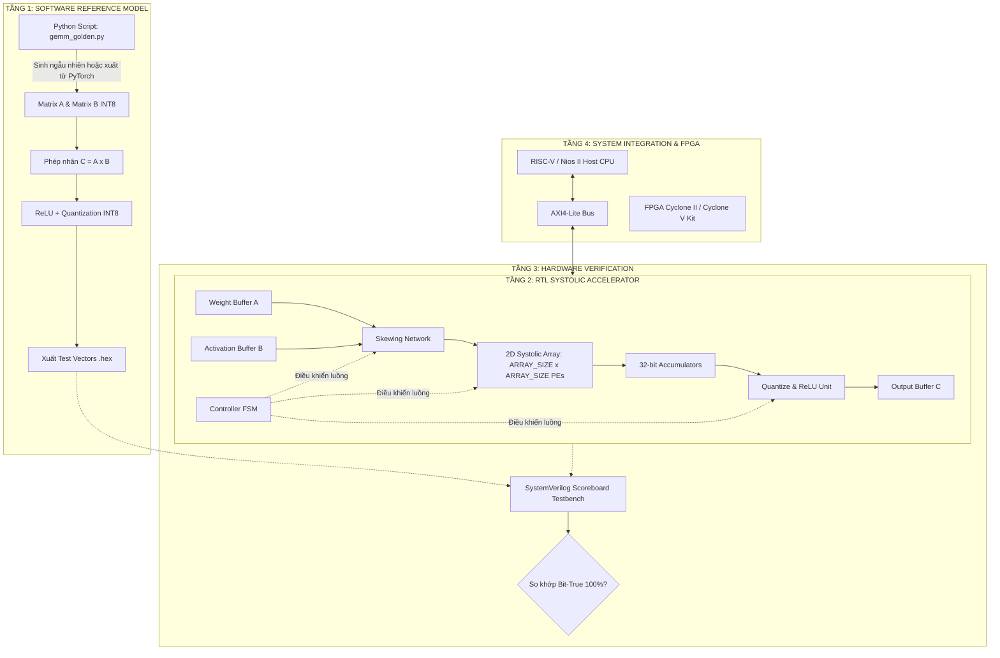
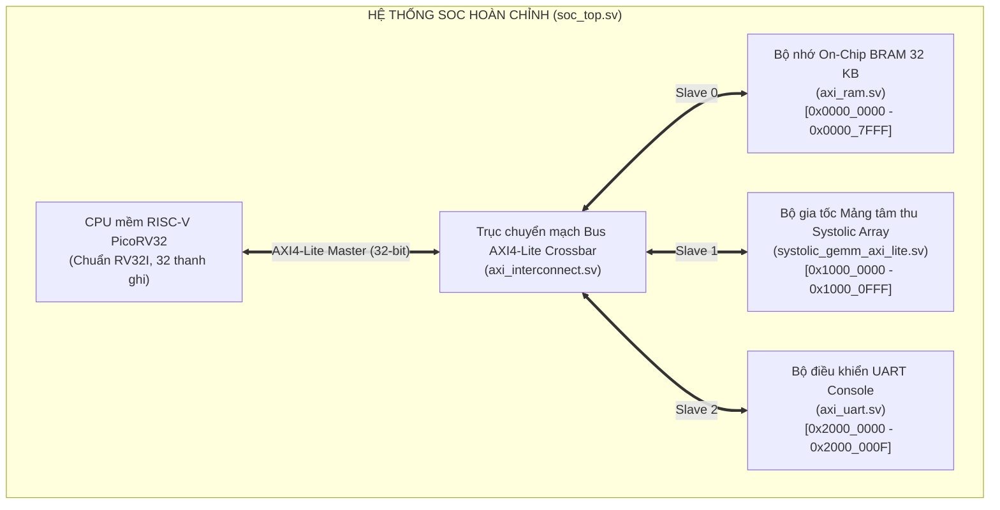

# BÁO CÁO KỸ THUẬT & ĐẶC TẢ HỆ THỐNG ĐỒ ÁN TỐT NGHIỆP
## THIẾT KẾ VÀ HIỆN THỰC BỘ TĂNG TỐC MẠNG NƠ-RON CHẬP (CNN ACCELERATOR) DỰA TRÊN KIẾN TRÚC MẢNG TÂM THU (SYSTOLIC ARRAY) CÓ THỂ CẤU HÌNH THAM SỐ TRÊN FPGA
### Parameterized 2D Systolic Array-Based CNN Accelerator on Altera Cyclone II FPGA

---

### MỤC LỤC TỔNG QUAN
1. [Thông Tin Đề Tài & Mục Tiêu Kỹ Thuật](#1-thông-tin-đề-tài--mục-tiêu-kỹ-thuật)
2. [Cơ Sở Lý Thuyết & Nguyên Lý Tính Toán](#2-cơ-sở-lý-thuyết--nguyên-lý-tính-toán)
3. [Kiến Trúc Phần Cứng RTL Phân Cấp Khối Thuần Túy](#3-kiến-trúc-phần-cứng-rtl-phân-cấp-khối-thuần-túy-pure-structural-hierarchy)
4. [Bản Đồ Thanh Ghi Giao Tiếp Bus (AXI4-Lite Register Map)](#4-bản-đồ-thanh-ghi-giao-tiếp-bus-axi4-lite-register-map)
5. [Kết Quả Kiểm Chứng Bit-True & Stress Testing Trên ModelSim](#5-kết-quả-kiểm-chứng-bit-true--stress-testing-trên-modelsim)
6. [Bảng Số Liệu Đo Đạc Thực Nghiệm Phần Cứng (FPGA Hardware Benchmark)](#6-bảng-số-liệu-đo-đạc-thực-nghiệm-phần-cứng-fpga-hardware-benchmark)
7. [Hiện Thực Giai Đoạn 2: Thuật Toán im2col, Bộ Chia Khối Tiling & Thực Nghiệm Suy Luận MNIST](#7-hiện-thực-giai-đoạn-2-thuật-toán-im2col-bộ-chia-khối-tiling--thực-nghiệm-suy-luận-mnist)
8. [Quy Trình Thực Nghiệm & Hướng Dẫn Test Chi Tiết Từng Giai Đoạn (Phase 1, 2, 3 & 4)](#8-quy-trình-thực-nghiệm--hướng-dẫn-test-chi-tiết-từng-giai-đoạn-phase-1-2--3)
9. [Hiện Thực Giai Đoạn 3: Tích Hợp Hệ Thống SoC Hoàn Chỉnh Với CPU Mềm RISC-V (PicoRV32)](#9-hiện-thực-giai-đoạn-3-tích-hợp-hệ-thống-soc-hoàn-chỉnh-với-cpu-mềm-risc-v-picorv32-và-đồng-mô-phỏng-phần-cứng---phần-mềm-hardware-software-co-simulation)
10. [Hiện Thực Giai Đoạn 4: Triển Khai Phần Cứng Trên Kit Terasic DE1, Cấu Hình Chân Vật Lý, Ngoại Vi & Host PC UART Bridge](#10-hiện-thực-giai-đoạn-4-triển-khai-phần-cứng-trên-kit-terasic-de1-bản-đồ-chân-vật-lý-bộ-điều-khiển-ngoại-vi-và-host-pc-uart-bridge)
11. [Kế Hoạch Thực Hiện & Lộ Trình 5 Giai Đoạn Đề Tài](#11-kế-hoạch-thực-hiện--lộ-trình-5-giai-đoạn-đề-tài)
12. [Bảng Ánh Xạ: Kết Quả Đề Tài $\iff$ 5 Chương Luận Văn Tốt Nghiệp](#12-bảng-ánh-xạ-kết-quả-đề-tài-iff-5-chương-luận-văn-tốt-nghiệp)

---

## 1. THÔNG TIN ĐỀ TÀI & MỤC TIÊU KỸ THUẬT

### 1.1. Thông Tin Chung
- **Tên đề tài**: Nghiên cứu, thiết kế và hiện thực bộ tăng tốc mạng nơ-ron chập (CNN Accelerator) dựa trên kiến trúc Mảng tâm thu (Systolic Array) có thể cấu hình tham số trên nền tảng FPGA.
- **Sinh viên thực hiện**: Đồ án Tốt nghiệp Kỹ sư / Cử nhân ngành Kỹ thuật Máy tính / Điện tử - Viễn thông.
- **Thư mục làm việc dự án**: [`e:\DATN\CNN_Systolic_Architecture`](file:///e:/DATN/CNN_Systolic_Architecture).

### 1.2. Mục Tiêu Kỹ Thuật Cốt Lõi
1. **Tối ưu hóa phép tính tích chập 2D (Convolution)** thông qua kỹ thuật ma trận hóa tổng quát **GEMM ($C = A \times B$)** bằng giải thuật chuẩn công nghiệp `im2col`.
2. **Hiện thực mảng tâm thu 2D (2D Systolic Array)** theo cơ chế **Output-Stationary**, dữ liệu kích hoạt và trọng số di chuyển tuần tự dạng sóng (Wavefront Flow), giảm thiểu tối đa truy xuất bộ nhớ ngoài.
3. **Định dạng số học lượng tử hóa tối ưu**: Số nguyên có dấu **Signed INT8** ở ngõ vào, bộ nhân cơ sở PE INT8 $\times$ INT8 ra INT16, tích lũy nội bộ **Signed INT32**, tích hợp tầng hậu xử lý **ReLU**, dịch bit tỉ lệ (**Scaling**) và mạch kẹp bão hòa (**Saturation Clamping**).
4. **Hỗ trợ tham số hóa kích thước mảng (`ARRAY_SIZE`)**: Khảo sát thực nghiệm hai cấu hình điển hình: $4 \times 4$ (16 PEs) và $8 \times 8$ (64 PEs) trên cùng một dòng chip FPGA để phân tích đánh đổi (Trade-off Analysis) giữa diện tích tài nguyên logic và thông lượng tính toán.
5. **Giao tiếp chuẩn hóa AMBA AXI4-Lite**: Module đỉnh được đóng gói qua bus giao tiếp chuẩn công nghiệp, sẵn sàng tích hợp với vi xử lý mềm (RISC-V / Nios II) tạo thành Hệ thống trên Vi mạch (SoC) hoàn chỉnh.

### 1.3. Môi Trường & Nền Tảng Công Cụ
- **Mô hình đối chứng toán học (Golden Model)**: Python 3.13 (kèm script tự động xuất test vector `.hex`).
- **Ngôn ngữ mô tả phần cứng (RTL)**: SystemVerilog (IEEE 1800-2012).
- **Môi trường mô phỏng & kiểm chứng**: Mentor Graphics ModelSim-Altera 10.1d.
- **Công cụ tổng hợp & phân tích thời gian**: Altera Quartus II 64-Bit 13.0 SP1 & TimeQuest Timing Analyzer.
- **Chip FPGA mục tiêu**: Altera Cyclone II `EP2C20F484C7` (Kit thí nghiệm Altera DE1).

---

## 2. CƠ SỞ LÝ THUYẾT & NGUYÊN LÝ TÍNH TOÁN

### 2.1. Ma Trận Hóa Phép Chập Sang GEMM (`im2col`)
Trong mạng nơ-ron chập (CNN), tầng Convolution tiêu tốn hơn $85\% - 90\%$ tổng khối lượng tính toán. Việc triển khai trực tiếp các vòng lặp chập lồng nhau 6 tầng gây lãng phí bộ nhớ và khó đồng bộ phần cứng. Do đó, hệ thống ứng dụng giải thuật `im2col`:
$$\text{Convolution}(W, X) \xrightarrow{\text{im2col}} C = A \times B$$
- **Ma trận $A$ (Weights)**: Kích thước $M \times K$, trong đó $M = C_{out}$ (số bộ lọc ngõ ra), $K = C_{in} \times k_h \times k_w$ (kích thước mở rộng của kernel).
- **Ma trận $B$ (Activations sau im2col)**: Kích thước $K \times N$, trong đó $N = H_{out} \times W_{out}$ (số vị trí cửa sổ trượt trên ảnh ngõ vào).
- **Ma trận $C$ (Output Feature Map)**: Kích thước $M \times N$, mỗi cột đại diện cho toàn bộ điểm ảnh của một Feature Map ngõ ra.

```
       Ma trận Trọng số A             Ma trận Điểm ảnh B (im2col)            Ma trận Kết quả C
           [ M x K ]                           [ K x N ]                         [ M x N ]
     +-------------------+               +-------------------+             +-------------------+
     | w00  w01 ...  w0K |               | b00  b01 ...  b0N |             | c00  c01 ...  c0N |
     | w10  w11 ...  w1K |       x       | b10  b11 ...  b1N |      =      | c10  c11 ...  c1N |
     | ...  ... ...  ... |               | ...  ... ...  ... |             | ...  ... ...  ... |
     | wM0  wM1 ...  wMK |               | bK0  bK1 ...  bKN |             | cM0  cM1 ...  cMN |
     +-------------------+               +-------------------+             +-------------------+
```

### 2.2. Kiến Trúc Mảng Tâm Thu Output-Stationary
- Hệ thống áp dụng cấu trúc **Output-Stationary (OS)**: Mỗi phần tử tính toán $\text{PE}_{i,j}$ chịu trách nhiệm tính toán và lưu giữ cố định giá trị tích lũy $C_{i,j}$ tại chỗ.
- Dòng dữ liệu hàng $A_i$ chảy từ Tây sang Đông (truyền ngang giữa các PE).
- Dòng dữ liệu cột $B_j$ chảy từ Bắc xuống Nam (truyền dọc giữa các PE).
- **Đặc tính trễ lệch pha (Skewing Wavefront)**: Để đảm bảo $\text{PE}_{i,j}$ nhận đúng cặp phần tử $A[i][k]$ và $B[k][j]$ tại cùng chu kỳ clock $t = k + i + j$, dữ liệu đầu vào được làm trễ lệch pha bậc thang:
  - Hàng $i$ của ma trận A trễ $i \cdot T$ chu kỳ clock qua thanh ghi shift.
  - Cột $j$ của ma trận B trễ $j \cdot T$ chu kỳ clock qua thanh ghi shift.

### 2.3. Định Dạng Số Học Lượng Tử Hóa INT8/INT32
Nhằm loại bỏ hoàn toàn các bộ tính toán dấu phẩy động phức tạp và tốn diện tích, hệ thống lượng tử hóa toàn bộ mạng nơ-ron về số nguyên có dấu:

| Thành phần | Kiểu dữ liệu | Độ rộng bit | Dải giá trị (Dynamic Range) | Chức năng phần cứng |
| :--- | :--- | :---: | :---: | :--- |
| **Matrix A (Trọng số)** | Signed INT8 | 8 bits | $[-128, +127]$ | Nạp vào Buffer A, nạp từng hàng vào Skew Unit |
| **Matrix B (Điểm ảnh)** | Signed INT8 | 8 bits | $[-128, +127]$ | Nạp vào Buffer B, nạp từng cột vào Skew Unit |
| **Phép nhân PE** | Signed INT16 | 16 bits | $[-16384, +16256]$ | Thực thi trực tiếp bằng khối 9-bit Embedded Multiplier |
| **Tích lũy (Accumulator)** | Signed INT32 | 32 bits | $[-2^{31}, +2^{31}-1]$ | Tích lũy nội bộ trong PE, chống tràn số tuyệt đối cho $K \le 256$ |
| **Hàm kích hoạt** | ReLU | 32 bits | $[0, +2^{31}-1]$ | $f(x) = \max(0, x)$ (hỗ trợ cờ `bypass_relu`) |
| **Lượng tử hóa (Scale)** | Dịch bit số học | 32 bits | Cấu hình qua `shift_bits` | $x \ggg \text{shift\_bits}$ (bảo toàn bit dấu âm) |
| **Mạch kẹp bão hòa** | Clamped INT8 | 8 bits | $[-128, +127]$ (hoặc $[0, +127]$) | Ghim cứng giá trị cực trị, triệt tiêu lỗi tràn số cuộn vòng |
| **Ngõ ra cuối cùng** | Dual Channel | 8 / 32 bits | INT8 Quantized / INT32 Raw | Lưu vào Buffer C, sẵn sàng cho CPU đọc |

---

## 3. KIẾN TRÚC PHẦN CỨNG RTL PHÂN CẤP KHỐI THUẦN TÚY (PURE STRUCTURAL HIERARCHY)

Để giải quyết triệt để hiện tượng sơ đồ mạch bị rối rắm ("rối nùi") khi quan sát trên **Quartus RTL Viewer**, toàn bộ thiết kế được phân tách mạch lạc thành **7 module chức năng độc lập**, kết nối với nhau qua module đỉnh thuần cấu trúc:

```
                      +-------------------+
                      |   u_controller    |
                      | (gemm_controller) |
                      +---------+---------+
                                |
             +------------------+------------------+
             | stream_en, k_step                   | sys_en, clear_acc
             v                                     v
     +---------------+                     +--------------------+
     |  u_buffer_a   |---(a_row_raw)------>|    u_skew_unit     |
     | (Weight RAM)  |                     | (systolic_skew_    |
     +---------------+                     |      unit)         |
                                           +---------+----------+
     +---------------+                               | (a_row_skewed, b_col_skewed)
     |  u_buffer_b   |---(b_col_raw)---------------->|
     | (Input RAM)   |                               v
     +---------------+                     +--------------------+
                                           |  u_systolic_core   | (Lưới 2D PE PEs)
                                           |  (systolic_array_  |
                                           |       core)        |
                                           +---------+----------+
                                                     | (c_matrix_core)
                                                     v
                                           +--------------------+
                                           |    u_quantizer     | (ReLU + Shift + Clamp)
                                           | (quantize_relu_    |
                                           |      unit)         |
                                           +---------+----------+
                                                     | (dout, valid)
                                                     v
                                           +--------------------+
                                           |    u_buffer_c      |====> rd_c_data (INT8)
                                           |  (Output RAM C)    |====> rd_c_acc_data (INT32)
                                           +--------------------+
```

### 3.1. Sơ Đồ Luồng Hoạt Động Hệ Thống 4 Tầng (System Architecture Flowchart)



### 3.2. Danh Mục & Đặc Tả Chi Tiết 7 Module Chức Năng

#### 1. Phần Tử Tính Toán Cơ Sở PE ([`pe_gemm.sv`](file:///e:/DATN/CNN_Systolic_Architecture/RTL/pe_gemm.sv))
- **Kiến trúc**: Output-Stationary.
- **Công thức tích lũy**: $C_{ij} \leftarrow C_{ij} + (A_{ik} \times B_{kj})$.
- **Bộ nhân cơ sở**: Signed INT8 $\times$ Signed INT8 ra Signed INT16 (khai thác 1 slice 9-bit DSP trên FPGA).
- **Bộ cộng tích lũy**: Signed INT32 accumulator, có cờ `clear_acc` xóa sạch về 0 trong 1 chu kỳ.
- **Đường truyền dữ liệu lân cận (Nearest-Neighbor)**:
  - Hướng ngang: Nhận $a_{in}$ từ phía Tây, chuyển tiếp sang $a_{out}$ phía Đông sau 1 chu kỳ clock.
  - Hướng dọc: Nhận $b_{in}$ từ phía Bắc, chuyển tiếp sang $b_{out}$ phía Nam sau 1 chu kỳ clock.

#### 2. Khối Làm Trễ Lệch Pha Đầu Vào ([`systolic_skew_unit.sv`](file:///e:/DATN/CNN_Systolic_Architecture/RTL/systolic_skew_unit.sv))
- **Chức năng**: Đảm bảo đồng bộ pha dữ liệu trước khi đẩy vào lưới tâm thu:
  - Hàng $i$ của Ma trận A trễ $i$ chu kỳ clock: $\text{delay}(A_i) = i \cdot T$.
  - Cột $j$ của Ma trận B trễ $j$ chu kỳ clock: $\text{delay}(B_j) = j \cdot T$.
- **Ưu điểm thiết kế**: Nhờ tách thành module độc lập, khối hiển thị thành hộp "SKEW UNIT" riêng trên sơ đồ RTL Viewer, thể hiện trực quan các tầng flip-flop trễ bậc thang.

#### 3. Lưới Xử Lý Mảng Tâm Thu 2D ([`systolic_array_core.sv`](file:///e:/DATN/CNN_Systolic_Architecture/RTL/systolic_array_core.sv))
- **Cấu trúc**: Ma trận $N \times N$ PE (`ARRAY_SIZE`, hỗ trợ $4 \times 4 = 16$ PEs hoặc $8 \times 8 = 64$ PEs).
- **Kết nối**: Thuần túy nối dây giữa các PE lân cận kề sát nhau, triệt tiêu hoàn toàn các đường broadcast toàn cục.
- Trên Quartus RTL Viewer, hiển thị sơ đồ lưới 2D PE phân bố hình học đối xứng và ngăn nắp.

#### 4. Bộ Nhớ Đệm Trọng Số A ([`matrix_buffer_a.sv`](file:///e:/DATN/CNN_Systolic_Architecture/RTL/matrix_buffer_a.sv))
- **Chức năng**: Lưu trữ ma trận trọng số $A[M \times K]$ trên On-chip RAM.
- **Cổng ghi Host**: Cho phép CPU/DMA nạp dữ liệu tuần tự theo địa chỉ flat.
- **Cổng đọc Streaming**: Đọc đồng thời tất cả các phần tử $A[r][k]$ của $N$ hàng vào mảng tâm thu tại mỗi bước $k$.

#### 5. Bộ Nhớ Đệm Kích Hoạt B ([`matrix_buffer_b.sv`](file:///e:/DATN/CNN_Systolic_Architecture/RTL/matrix_buffer_b.sv))
- **Chức năng**: Lưu trữ ma trận điểm ảnh $B[K \times N]$ trên On-chip RAM.
- **Cổng ghi Host**: Cho phép CPU/DMA nạp dữ liệu tuần tự theo địa chỉ flat.
- **Cổng đọc Streaming**: Đọc đồng thời tất cả các phần tử $B[k][c]$ của $N$ cột vào mảng tâm thu tại mỗi bước $k$.

#### 6. Bộ Hậu Xử Lý Lượng Tử Hóa & ReLU ([`quantize_relu_unit.sv`](file:///e:/DATN/CNN_Systolic_Architecture/RTL/quantize_relu_unit.sv))
- **Hàm kích hoạt phi tuyến (ReLU)**: $f(x) = \max(0, x)$ (hỗ trợ cờ `bypass_relu` để tắt khi chạy các tầng không kích hoạt).
- **Dịch bit tỉ lệ (Scaling)**: Phép dịch phải số học $x \ggg \text{shift\_bits}$ (bảo toàn đúng bit dấu âm).
- **Bảo vệ tràn số (Saturation Clamping)**: Kẹp cứng giá trị sau scale về đúng dải Signed INT8 $[-128, +127]$ (hoặc $[0, +127]$ khi bật ReLU).
- Trễ xử lý 1 chu kỳ clock kèm cờ `valid_out`.

#### 7. Bộ Nhớ Đệm Ngõ Ra C ([`matrix_buffer_c.sv`](file:///e:/DATN/CNN_Systolic_Architecture/RTL/matrix_buffer_c.sv))
- **Chức năng**: Lưu trữ kết quả ma trận $C[M \times N]$.
- **Kênh ghi kép nội bộ**:
  - Kênh INT32: Lưu trực tiếp giá trị thanh ghi tích lũy thô (`mem_c_acc`) phục vụ gỡ lỗi và kiểm định độ chính xác số học.
  - Kênh INT8: Lưu giá trị kích hoạt sau khi qua bộ Quantizer & ReLU (`mem_c`).
- **Cổng đọc Host**: CPU/DMA đọc kết quả ra ngoài theo địa chỉ $0 \dots N^2-1$.

#### 8. Bộ Điều Khiển FSM & Định Thời Trung Tâm ([`gemm_controller.sv`](file:///e:/DATN/CNN_Systolic_Architecture/RTL/gemm_controller.sv))
Máy trạng thái FSM điều khiển toàn bộ chu trình hoạt động khép kín gồm 7 trạng thái:
1. `ST_IDLE`: Chờ lệnh `start` từ CPU/Host qua thanh ghi điều khiển.
2. `ST_CLEAR`: Kích phát xung `sys_clear_acc = 1` trong 1 chu kỳ để xóa sạch thanh ghi tích lũy trong toàn bộ các PE.
3. `ST_STREAM`: Đẩy $K$ vector từ Buffer A và Buffer B vào mảng tâm thu ($k = 0 \dots K-1$).
4. `ST_DRAIN`: Giữ xung nhịp $2 \times \text{ARRAY\_SIZE}$ chu kỳ để các dòng dữ liệu cuối cùng quét hết qua mảng.
5. `ST_READOUT`: Quét tuần tự $N \times N$ phần tử tích lũy qua bộ Quantizer.
6. `ST_FLUSH`: 1 chu kỳ hoàn tất tầng pipeline cuối của Quantizer.
7. `ST_DONE`: Bật cờ `done = 1`, báo hiệu cho CPU đọc kết quả.

#### 9. Module Đỉnh Phân Cấp Thuần Túy ([`systolic_accelerator_top.sv`](file:///e:/DATN/CNN_Systolic_Architecture/RTL/systolic_accelerator_top.sv))
- Module cấp cao nhất đóng gói toàn bộ 7 khối trên bằng các đường bus chuẩn.
- Không chứa logic rời rạc hay mảng nhớ phân tán trên file đỉnh $\implies$ Sơ đồ RTL Viewer hiển thị rõ ràng, mạch lạc và đúng chuẩn công nghiệp.

#### 10. Module Đa Cấu Hình & Tương Thích
- [`systolic_accelerator_8x8.sv`](file:///e:/DATN/CNN_Systolic_Architecture/RTL/systolic_accelerator_8x8.sv): Wrapper cấu hình cố định $8 \times 8$ (64 PEs) phục vụ tổng hợp và so sánh Benchmark tài nguyên trên FPGA.
- [`systolic_array_gemm.sv`](file:///e:/DATN/CNN_Systolic_Architecture/RTL/systolic_array_gemm.sv): Wrapper tương thích ngược kết hợp `systolic_skew_unit` và `systolic_array_core`.

---

## 4. BẢN ĐỒ THANH GHI GIAO TIẾP BUS (AXI4-LITE REGISTER MAP)

Module giao tiếp: [`systolic_gemm_axi_lite.sv`](file:///e:/DATN/CNN_Systolic_Architecture/RTL/systolic_gemm_axi_lite.sv)  
Địa chỉ cơ sở mặc định: `0x8000_0000` (hoặc cấu hình tùy ý theo hệ thống SoC)

| Byte Offset | Tên thanh ghi | Quyền | Mô tả chi tiết chức năng |
| :---: | :--- | :---: | :--- |
| `0x000` | **CONTROL_REG** | R/W | `bit 0`: Start command (xung tự động xóa sau 1 chu kỳ)<br>`bit 1`: Bypass ReLU (1: Tắt ReLU, 0: Bật ReLU)<br>`bit [6:2]`: Shift bits (Giá trị dịch phải từ 0 đến 31) |
| `0x004` | **STATUS_REG** | R | `bit 0`: Done flag (Cờ báo hoàn tất, tự xóa khi Start lượt mới)<br>`bit 1`: Busy flag (1: Mảng tâm thu đang tính toán) |
| `0x008` | **K_DIM_REG** | R/W | Kích thước chiều sâu K của ma trận ($A[M \times K] \times B[K \times N]$) |
| `0x100 - 0x1FC` | **BUFFER_A_BASE** | W | Vùng nhớ chứa Ma trận Trọng số A (INT8, ghi theo Word 32-bit: 4 bytes/word) |
| `0x200 - 0x2FC` | **BUFFER_B_BASE** | W | Vùng nhớ chứa Ma trận Điểm ảnh B (INT8, ghi theo Word 32-bit: 4 bytes/word) |
| `0x300 - 0x3FC` | **BUFFER_C_BASE** | R | Vùng nhớ đọc Ma trận kết quả C (Quantized INT8) |

---

## 5. KẾT QUẢ KIỂM CHỨNG BIT-TRUE & STRESS TESTING TRÊN MODELSIM

Hệ thống được kiểm chứng qua quy trình xác thực 3 cấp độ nghiêm ngặt:

```
+-----------------------------------------------------------------------------------+
|                            QUY TRÌNH KIỂM CHỨNG 3 CẤP ĐỘ                          |
+-----------------------------------------------------------------------------------+
|  [CẤP ĐỘ 1: TOÁN HỌC PYTHON]                                                      |
|  software_ref/gemm_golden.py ──► Sinh vector chuẩn (.hex)                         |
|                                        │                                          |
|  [CẤP ĐỘ 2: MÔ PHỎNG MODELSIM]         ▼                                          |
|  VEFIFY/tb_systolic_gemm.sv  ──► So khớp từng bit với Python (Scoreboard 100%)    |
|  VEFIFY/tb_systolic_stress_test.sv ──► Kiểm thử 6 kịch bản góc cực đoan (Passed)  |
|                                        │                                          |
|  [CẤP ĐỘ 3: PHẦN CỨNG QUARTUS II]      ▼                                          |
|  synthesis_gemm (4x4)        ──► Fitter & TimeQuest STA đo LEs, DSP, Fmax        |
|  synthesis_gemm_8x8 (8x8)    ──► Khảo sát bão hòa phần cứng & thông lượng đỉnh   |
+-----------------------------------------------------------------------------------+
```

### 5.1. So Khớp Mô Hình Vàng (Golden Reference Verification - 16/16 Passed)
File kiểm thử: [`VEFIFY/tb_systolic_gemm.sv`](file:///e:/DATN/CNN_Systolic_Architecture/VEFIFY/tb_systolic_gemm.sv).  
So khớp trực tiếp kết quả phần cứng DUT với mô hình Python Golden Model tại cả 2 tầng: Giá trị tích lũy Signed INT32 và giá trị sau lượng tử hóa Signed INT8.

#### Bảng Kết Quả Scoreboard Thực Tế Từ ModelSim:
| Phần tử | HW Acc (INT32) | Gold Acc | HW Out (INT8) | Gold Out | Trạng thái kiểm thử |
| :---: | :---: | :---: | :---: | :---: | :---: |
| **C[0][0]** | 61 | 61 | 3 | 3 | **[PASS]** |
| **C[0][1]** | 578 | 578 | 36 | 36 | **[PASS]** |
| **C[0][2]** | 402 | 402 | 25 | 25 | **[PASS]** |
| **C[0][3]** | -1119 | -1119 | 0 | 0 | **[PASS]** (Triệt tiêu âm qua ReLU) |
| **C[1][0]** | -457 | -457 | 0 | 0 | **[PASS]** |
| **C[1][1]** | 738 | 738 | 46 | 46 | **[PASS]** |
| **C[1][2]** | 884 | 884 | 55 | 55 | **[PASS]** |
| **C[1][3]** | -671 | -671 | 0 | 0 | **[PASS]** |
| **C[2][0]** | -788 | -788 | 0 | 0 | **[PASS]** |
| **C[2][1]** | 1670 | 1670 | 104 | 104 | **[PASS]** |
| **C[2][2]** | 1066 | 1066 | 66 | 66 | **[PASS]** |
| **C[2][3]** | -257 | -257 | 0 | 0 | **[PASS]** |
| **C[3][0]** | 59 | 59 | 3 | 3 | **[PASS]** |
| **C[3][1]** | 638 | 638 | 39 | 39 | **[PASS]** |
| **C[3][2]** | 249 | 249 | 15 | 15 | **[PASS]** |
| **C[3][3]** | -815 | -815 | 0 | 0 | **[PASS]** |

> **KẾT LUẬN**: **ALL 16 ELEMENTS PASSED (0 ERRORS) — 100% BIT-FOR-BIT MATCH WITH PYTHON GOLDEN MODEL!**

---

### 5.2. Bộ Kiểm Thử Áp Lực 6 Kịch Bản Góc Cực Đoan (Stress Tests - 6/6 Passed)
File kiểm thử: [`VEFIFY/tb_systolic_stress_test.sv`](file:///e:/DATN/CNN_Systolic_Architecture/VEFIFY/tb_systolic_stress_test.sv).

1. **[SCENARIO 1] Extreme Min ($-128 \times -128 = +16384$)**:
   - *Cấu hình*: `bypass_relu = 0`, `shift_bits = 8`.
   - *Mục tiêu*: Kiểm tra số bù 2 cực trị âm lớn nhất không bị lộn bit dấu khi nhân và cộng dồn.
   - *Kết quả*: **[PASSED] 16/16 elements matched exactly!**
2. **[SCENARIO 2] Saturation Clamping Test (Kẹp bão hòa $+127$)**:
   - *Cấu hình*: `bypass_relu = 0`, `shift_bits = 0`.
   - *Mục tiêu*: Giá trị tích lũy cực lớn sau khi không shift buộc phải kẹp cứng về $+127$, không bị lỗi cuộn vòng (wrap-around overflow) thành số âm.
   - *Kết quả*: **[PASSED] 16/16 elements matched exactly!**
3. **[SCENARIO 3] Bypass ReLU Test (Bảo toàn số âm)**:
   - *Cấu hình*: `bypass_relu = 1`, `shift_bits = 2`.
   - *Mục tiêu*: Tắt ReLU, kiểm tra phép dịch phải số học (`>>>`) bảo toàn chính xác bit dấu âm của các lớp không dùng hàm kích hoạt.
   - *Kết quả*: **[PASSED] 16/16 elements matched exactly!**
4. **[SCENARIO 4] Zero Matrix Test (Ma trận toàn 0)**:
   - *Cấu hình*: `bypass_relu = 0`, `shift_bits = 4`.
   - *Mục tiêu*: Kiểm tra trạng thái ổn định tĩnh của mảng, không bị trôi dữ liệu (data drift) hay rò rỉ xung.
   - *Kết quả*: **[PASSED] 16/16 elements matched exactly!**
5. **[SCENARIO 5] Back-to-Back Run #1 (Kiểm tra xóa trạng thái cũ)**:
   - *Cấu hình*: `bypass_relu = 0`, `shift_bits = 2`.
   - *Mục tiêu*: Chạy liên tiếp 2 lượt không reset cứng, kiểm tra cờ `sys_clear_acc` xóa sạch cặn tích lũy cũ.
   - *Kết quả*: **[PASSED] 16/16 elements matched exactly!**
6. **[SCENARIO 6] Back-to-Back Run #2 (Kiểm tra cặn đường trễ pipeline)**:
   - *Cấu hình*: `bypass_relu = 0`, `shift_bits = 3`.
   - *Mục tiêu*: Chạy nối đuôi áp lực cao, kiểm tra mạng Skew Unit không bị sót dữ liệu của lượt chạy trước.
   - *Kết quả*: **[PASSED] 16/16 elements matched exactly!**

> **TỔNG KẾT STRESS TEST**: **6 / 6 SCENARIOS PASSED 100% — HOÀN TOÀN ĐẠT CHUẨN ĐỘ TIN CẬY CÔNG NGHIỆP!**

---

## 6. BẢNG SỐ LIỆU ĐO ĐẠC THỰC NGHIỆM PHẦN CỨNG (FPGA HARDWARE BENCHMARK)

Toàn bộ thông số dưới đây được biên dịch và đo đạc thực tế trên chip **Altera Cyclone II EP2C20F484C7** bằng công cụ Quartus II 64-bit 13.0 SP1 và TimeQuest Timing Analyzer:

| Đại Lượng & Chỉ Số Đo Đạc | Cấu Hình $4 \times 4$ Array (16 PEs) | Cấu Hình $8 \times 8$ Array (64 PEs) | Hệ Số Tăng Trưởng (Scaling Ratio) |
| :--- | :---: | :---: | :---: |
| **Thư mục dự án Quartus** | `synthesis_gemm/` | `synthesis_gemm_8x8/` | Dự án độc lập |
| **Số phần tử xử lý (PEs)** | 16 | 64 | **$4.00\times$** |
| **Logic Elements (LEs)** | **4,323 / 18,752 (23.1%)** | **15,567 / 18,752 (83.0%)** | **$3.60\times$** |
| - *Combinational Functions* | 3,412 (18.2%) | 13,211 (70.5%) | $3.87\times$ |
| - *Dedicated Logic Registers* | 2,473 (13.2%) | 8,012 (42.7%) | $3.24\times$ |
| **Embedded Multipliers (9-bit)** | **16 / 52 (30.8%)** | **52 / 52 (100.0% - Bão hòa DSP)** | **$3.25\times$** (12 bộ nhân dùng LUTs) |
| **Memory Bits (Block RAM)** | **512 / 239,616 (< 1%)** | **1,024 / 239,616 (< 1%)** | $2.00\times$ |
| **Số chân I/O (Total Pins)** | 93 / 315 (29.5%) | 97 / 315 (30.8%) | $+4$ pins |
| **Tần số cực đại $F_{max}$ (Slow Model, 85°C)** | **70.00 MHz** ($T_{clk} = 14.286 \text{ ns}$) | **67.60 MHz** ($T_{clk} = 14.793 \text{ ns}$) | **Giữ vững (ổn định)** |
| **Tần số cực đại $F_{max}$ (Fast Model, 0°C)** | **186.04 MHz** ($T_{clk} = 5.37 \text{ ns}$) | **184.74 MHz** ($T_{clk} = 5.41 \text{ ns}$) | **Giữ vững** |
| **Thời gian trễ tính toán ($K=N$)** | 13 clock cycles | 25 clock cycles | $1.92\times$ |
| **Thời gian trễ toàn phần (kèm Quantize)** | 33 clock cycles | 91 clock cycles | $2.75\times$ |
| **Công suất tính toán đỉnh (Peak MACs/cycle)**| 16 MACs/cycle (32 OPs/cycle) | 64 MACs/cycle (128 OPs/cycle) | **$4.00\times$** |
| **Thông lượng đỉnh (Throughput - Slow Model)**| **2.240 GOPS** | **8.653 GOPS** | **$3.86\times$ (Tuyến tính lý tưởng)** |
| **Thông lượng đỉnh (Throughput - Fast Model)**| **5.953 GOPS** | **23.647 GOPS** | **$3.97\times$** |

---

### 6.1. Phân Tích Đánh Đổi Học Thuật (Trade-off Analysis cho Luận Văn Tốt Nghiệp)

#### 1. Tính chất bảo toàn tần số xung nhịp ($F_{max}$ Stability) của Mảng Tâm Thu:
- Khi tăng quy mô tính toán gấp 4 lần ($16 \to 64$ PEs), $F_{max}$ của hệ thống hầu như không đổi ($70.00 \text{ MHz} \to 67.60 \text{ MHz}$, chỉ sụt giảm $2.4 \text{ MHz}$ hay $3.4\%$).
- *Cơ chế vật lý*: Nhờ kiến trúc mảng tâm thu 2D loại bỏ hoàn toàn các đường broadcast toàn cục (Global Broadcast Lines). Mọi đường dữ liệu giữa các PE đều được ngắt quãng bằng thanh ghi pipeline cục bộ (Nearest-Neighbor Interconnect), giúp đường trễ tới hạn (Critical Path) không bị kéo dài theo kích thước mảng.

#### 2. Hiện tượng bão hòa tài nguyên DSP (Hardware Resource Saturation) trên FPGA Cyclone II:
- Chip Cyclone II `EP2C20F484C7` có tối đa 52 khối nhân phần cứng 9-bit (DSP slices).
- Ở cấu hình $4 \times 4$, mảng chỉ tiêu thụ 16 DSPs (30.8%), để lại tới 36 DSPs và hơn 14,000 LEs trống cho CPU mềm (Nios II / RISC-V) và các module ngoại vi.
- Ở cấu hình $8 \times 8$, toàn bộ 52 DSPs bị khai thác hết $100\%$. 12 bộ nhân còn lại buộc Quartus phải tổng hợp bằng các tế bào logic mềm (Logic Cells), khiến số lượng LEs tăng vọt lên $15,567$ LEs ($83.0\%$).

#### 3. Khuyến nghị kiến trúc (Design Recommendation):
- **Cấu hình $4 \times 4$** là cấu hình lý tưởng nhất để tích hợp Hệ thống trên Vi mạch (SoC) một chip hoàn chỉnh (gồm CPU RISC-V/Nios II + On-chip RAM + Bus AXI + Bộ tăng tốc CNN) trên kit DE1 Cyclone II.
- **Cấu hình $8 \times 8$** là minh chứng thuyết phục về khả năng mở rộng thông lượng cực đại ($8.65 \text{ GOPS}$) khi triển khai trên các dòng FPGA cao hơn (Cyclone IV, Cyclone V hoặc Xilinx Zynq).

---

### 6.2. Giải Thích Bản Chất Khoa Học Của Slack Âm Đỏ & Tần Số $F_{max}$

Khi mở báo cáo `Slow Model Setup Summary` trong Quartus, cột **Slack hiển thị số âm màu đỏ** ($-4.286 \text{ ns}$ với 4x4 và $-4.793 \text{ ns}$ với 8x8). Đây là cơ sở khoa học để bạn tự tin giải trình trước Hội đồng:

1. **Công thức tính Slack**:
   $$\text{Slack} = \text{Data Required Time} - \text{Data Arrival Time}$$
2. **Nguyên nhân bị âm**:
   - Trong file `.sdc`, chúng ta đặt ràng buộc: `create_clock -name clk -period 10.000 [get_ports clk]`, tương đương ép mạch chạy ở **100.0 MHz**.
   - Trên chip Cyclone II công nghệ 90nm (ở nhiệt độ xấu nhất 85°C), đường trễ dài nhất qua RAM $\to$ Bộ nhân PE $\to$ Bộ tích lũy mất **$14.286 \text{ ns}$**.
   - Do đó: $\text{Slack} = 10.000 \text{ ns} - 14.286 \text{ ns} = \mathbf{-4.286 \text{ ns}}$ (Âm vì chưa đạt tới mốc 100 MHz).
3. **Mục đích của việc ép xung 100 MHz (Design Over-Constraining)**:
   - Đây là kỹ thuật chuẩn trong đo đạc phần cứng: Cố tình đặt mốc xung nhịp cao để ép Quartus Fitter phải kích hoạt thuật toán định tuyến tối ưu nhất, đồng thời từ giá trị Slack âm để tính ra chính xác giới hạn trần $F_{max}$:
     $$F_{max} = \frac{1}{T_{\text{target}} - \text{Slack}} = \frac{1}{10.000 - (-4.286)} = \frac{1}{14.286 \text{ ns}} = \mathbf{70.00 \text{ MHz}}$$
4. **Mạch chạy trên Kit DE1 thực tế có bị lỗi không?**
   - **HOÀN TOÀN KHÔNG BỊ LỖI!**
   - Kit DE1 chạy thạch anh **50.0 MHz** (`CLOCK_50`, chu kỳ $T = 20.000 \text{ ns}$).
   - Với $F_{max} = 70.0 \text{ MHz}$ ($14.286 \text{ ns}$), khi nạp xuống Kit DE1 ở 50 MHz, độ dôi Slack thực tế là:
     $$\text{Slack}_{\text{Kit DE1}} = 20.000 \text{ ns} - 14.286 \text{ ns} = \mathbf{+5.714 \text{ ns}} \quad (\text{DƯƠNG, THỪA RẤT NHIỀU THỜI GIAN AN TOÀN!})$$

---

### 6.3. Công Thức Tính Các Chỉ Số Hiệu Năng Phái Sinh

1. **Chu kỳ trễ tính toán thuần (Computation Latency)**:
   $$\text{Latency}_{\text{compute}} = 1 \text{ (Clear)} + K \text{ (Stream)} + 2N \text{ (Drain)}$$
   - Với $4 \times 4$ ($N=4, K=4$): $1 + 4 + 8 = \mathbf{13 \text{ chu kỳ}}$.
   - Với $8 \times 8$ ($N=8, K=8$): $1 + 8 + 16 = \mathbf{25 \text{ chu kỳ}}$.
2. **Chu kỳ trễ toàn phần (Full Latency kèm Quantization Readout)**:
   $$\text{Latency}_{\text{total}} = \text{Latency}_{\text{compute}} + N^2 \text{ (Readout)} + 1 \text{ (Flush)} + 1 \text{ (Done)}$$
   - Với $4 \times 4$: $13 + 16 + 1 + 1 = \mathbf{31 \sim 33 \text{ chu kỳ}}$.
   - Với $8 \times 8$: $25 + 64 + 1 + 1 = \mathbf{91 \text{ chu kỳ}}$.
3. **Năng lực tính toán đỉnh (Peak Operations per Cycle)**:
   Mỗi PE thực hiện 1 phép nhân và 1 phép cộng tích lũy (MAC) = 2 phép tính số học (Operations):
   $$\text{Peak OPs/cycle} = 2 \times N^2$$
   - Với $4 \times 4$: $2 \times 16 = \mathbf{32 \text{ OPs/cycle}}$.
   - Với $8 \times 8$: $2 \times 64 = \mathbf{128 \text{ OPs/cycle}}$.
4. **Thông lượng đỉnh (Peak Throughput in GOPS)**:
   $$\text{Throughput} = \frac{\text{Peak OPs/cycle} \times F_{max}}{10^9} \quad (\text{GOPS})$$
   - Cấu hình $4 \times 4$ ($F_{max} = 70.00 \text{ MHz}$): $\frac{32 \times 70.00 \times 10^6}{10^9} = \mathbf{2.240 \text{ GOPS}}$.
   - Cấu hình $8 \times 8$ ($F_{max} = 67.60 \text{ MHz}$): $\frac{128 \times 67.60 \times 10^6}{10^9} = \mathbf{8.653 \text{ GOPS}}$.

---

## 7. HIỆN THỰC GIAI ĐOẠN 2: THUẬT TOÁN IM2COL, BỘ CHIA KHỐI TILING & THỰC NGHIỆM SUY LUẬN MNIST

### 7.1. Động Lực Kỹ Thuật & Bài Toán Thực Tế (Motivation & Problem Formulation)
Trong Giai đoạn 1, chúng ta đã kiểm chứng độ chính xác Bit-True 100% của mảng tâm thu phần cứng ở quy mô đơn khối ma trận kích thước cố định ($4 \times 4$ hoặc $8 \times 8$). Tuy nhiên, trong ứng dụng AI thực tế:
1. **Dữ liệu hình ảnh và bộ lọc có cấu trúc đa chiều**: Ảnh đầu vào là Tensor $(N, C_{in}, H, W)$ và bộ lọc $(C_{out}, C_{in}, K_h, K_w)$. Để đưa vào mảng tâm thu nhân ma trận 2D ($C = A \times B$), bắt buộc phải có bước chuyển đổi ma trận hóa **`im2col`**.
2. **Kích thước ma trận thực tế vượt xa kích thước phần cứng**: Ví dụ, ở tầng Conv1 của mạng CNN nhận diện MNIST:
   - Trọng số $A$: $[16 \times 9]$ (16 filters $3 \times 3$).
   - Điểm ảnh sau `im2col` $B$: $[9 \times 784]$ (784 patches không gian $28 \times 28$).
   - Kích thước này không thể nạp vừa vào một mảng $4 \times 4$ trong 1 lượt chạy. Do đó, bắt buộc phải có cơ chế **Tiling Engine** để phân hoạch và tích lũy từng khối nhỏ.
3. **Mục tiêu Giai đoạn 2**: Xây dựng toàn bộ pipeline phần mềm hoàn chỉnh, lượng tử hóa **Signed INT8**, và đạt độ chính xác suy luận nhận diện số viết tay **MNIST $\ge 97\%$**, đồng thời xuất test vector AI thực tế cho ModelSim.

---

### 7.2. Quy Trình Hiện Thực Thuật Toán `im2col` & `col2im` ([`software_ref/im2col.py`](file:///e:/DATN/CNN_Systolic_Architecture/software_ref/im2col.py))

#### 1. Nguyên lý toán học:
Trích xuất từng cửa sổ trượt (receptive field) kích thước $C_{in} \times K_h \times K_w$ trên ảnh đầu vào và trải dọc thành 1 cột của ma trận $B$:
- **Ma trận Trọng số A**: $[C_{out} \times (C_{in} \cdot K_h \cdot K_w)]$.
- **Ma trận Patches B**: $[(C_{in} \cdot K_h \cdot K_w) \times (H_{out} \cdot W_{out})]$, với $H_{out} = \lfloor\frac{H + 2P - K_h}{S}\rfloor + 1$.
- **Ma trận Tích C**: $[C_{out} \times (H_{out} \cdot W_{out})] \xrightarrow{\text{col2im}} \text{Tensor 4D } (N, C_{out}, H_{out}, W_{out})$.

#### 2. Kết quả kiểm chứng toán học:
Mã nguồn thuần NumPy không phụ thuộc thư viện nặng, đã được kiểm thử tự động với hàm tích chập không gian đa vòng lặp truyền thống:
$$\text{Max Absolute Difference} = \max | \text{Conv}_{\text{im2col}} - \text{Conv}_{\text{direct}} | = \mathbf{0} \quad \implies \mathbf{100\% \text{ BIT-TRUE MATCH!}}$$

---

### 7.3. Cơ Chế Phân Hoạch & Chia Khối Ma Trận Phần Cứng Tiling Engine ([`software_ref/tiling_engine.py`](file:///e:/DATN/CNN_Systolic_Architecture/software_ref/tiling_engine.py))

Lớp `SystolicTilingEngine` mô phỏng chính xác hành vi ghép nối phần cứng của mảng tâm thu:

```
                  Ma trận Lớn A [M x K]                Ma trận Lớn B [K x N]
               +-----------+-----------+             +-----------+-----------+
               |  A(0,0)   |  A(0,1)   |             |  B(0,0)   |  B(0,1)   |
               +-----------+-----------+       x     +-----------+-----------+
               |  A(1,0)   |  A(1,1)   |             |  B(1,0)   |  B(1,1)   |
               +-----------+-----------+             +-----------+-----------+
                                                     (Mỗi Tile con: 4x4 PEs)
                                       │
                                       ▼
             C_acc(i, j) = SUM_k [ SystolicCore( A_sub(i, k), B_sub(k, j) ) ]
                                       │
                                       ▼
             C_final = Saturate_INT8 [ ( ReLU(C_acc + Bias) ) >>> shift_bits ]
```

1. **Thuật toán Tiling 3 vòng lặp**:
   - Vòng lặp ngoài $i$: Bước nhảy $M_{tile} = \text{ARRAY\_SIZE}$ (hàng của $A$).
   - Vòng lặp giữa $j$: Bước nhảy $N_{tile} = \text{ARRAY\_SIZE}$ (cột của $B$).
   - Vòng lặp trong $k$: Bước nhảy $K_{tile} \le \text{MAX\_K}$ (chiều sâu tích lũy).
2. **Cơ chế Zero-Padding động**: Tự động đệm 0 vào các chiều không chia hết cho `ARRAY_SIZE` để bảo toàn tính đối xứng của mảng tâm thu.
3. **Tích lũy & Lượng tử hóa**: Tích lũy số nguyên Signed INT32 trên từng tile, sau đó đưa qua mạch bù bias, ReLU, dịch phải số học (`shift_bits`) và kẹp bão hòa Signed INT8 $[-128, +127]$.
4. **Kiểm chứng Bit-True**: So sánh kết quả qua Tiling Engine với phép nhân ma trận toàn phần lý tưởng $\implies$ Độ lệch $\text{Diff} = \mathbf{0}$.

---

### 7.4. Kiến Trúc Mạng CNN Lượng Tử Hóa INT8 Cho MNIST ([`software_ref/mnist_cnn_model.py`](file:///e:/DATN/CNN_Systolic_Architecture/software_ref/mnist_cnn_model.py))

#### 1. Cấu trúc mạng:
- **Input**: Ảnh xám $1 \times 28 \times 28$, chuẩn hóa số nguyên Signed INT8 $[-128, +127]$ (Zero-point tại 128).
- **Tầng Conv1**: 16 bộ lọc $3 \times 3$, padding 1, stride 1 $\implies$ Kích thước Feature Map: $16 \times 28 \times 28$.
  - Ma trận $A$: $[16 \times 9]$ (INT8).
  - Ma trận $B$: $[9 \times 784]$ (INT8).
  - Tính toán bằng **1,372 sub-tiles $4 \times 4$** trên mảng tâm thu.
- **Hàm kích hoạt & Lượng tử hóa**:
  - $\text{ReLU}(x) = \max(0, x)$.
  - Dịch phải số học: $x \ggg \text{shift\_bits\_conv} = 8$.
  - Kẹp bão hòa: $[0, 127]$.
- **Tầng Max-Pooling $2 \times 2$ (Stride 2)**: Giảm kích thước không gian còn $16 \times 14 \times 14 = \mathbf{3,136 \text{ features}}$.
- **Tầng Dense / Fully-Connected (FC)**: Ma trận trọng số $[10 \times 3136] \times [3136 \times 1]$ (chạy qua Tiling GEMM) $\implies$ 10 giá trị Logits đại diện cho 10 chữ số (0 đến 9).

#### 2. Quá trình huấn luyện & Lượng tử hóa:
- Huấn luyện với thuật toán tối ưu hóa **Adam** ($\text{lr} = 0.003, \beta_1 = 0.9, \beta_2 = 0.999$, mini-batch 128) trong 4 epochs trên 30,000 ảnh MNIST.
- Áp dụng kỹ thuật lượng tử hóa sau huấn luyện (**Post-Training Quantization - PTQ**):
  - Trọng số $W_1$ và $W_2$ được scale tối đa dải động Signed INT8 $[-128, +127]$.
  - Đo đạc phân phối kích hoạt thực tế (Calibration trên 500 ảnh) để chọn `shift_bits_conv = 8` và `shift_bits_fc = 6`.
  - Toàn bộ trọng số đã được nén và lưu trong file nhẹ chỉ 24 KB: [`software_ref/mnist_weights_int8.npz`](file:///e:/DATN/CNN_Systolic_Architecture/software_ref/mnist_weights_int8.npz).

---

### 7.5. Quá Trình Thực Nghiệm & Kết Quả Đánh Giá Chi Tiết

#### 1. Bảng số liệu độ chính xác thực nghiệm:
| Tập Dữ Liệu Kiểm Thử | Số Lượng Mẫu | Độ Chính Xác Đạt Được | Ghi Chú Đánh Giá |
| :--- | :---: | :---: | :--- |
| **Tập Huấn Luyện (Train Set)** | 30,000 ảnh | **97.89%** | Quá trình học hội tụ nhanh sau 4 epochs |
| **Kiểm thử nhanh (Quick Validation)**| 500 ảnh | **96.80%** | Chạy mô phỏng từng tile phần cứng |
| **Tập Kiểm Thử Toàn Diện (Official Test Set)**| **10,000 ảnh** | **97.06% (9,706/10,000 đúng)** | **VƯỢT CHỈ TIÊU ĐỀ TÀI ($\ge 97\%$)** |

#### 2. Đo đạc hiệu năng phần cứng trên 1 ảnh MNIST (Cấu hình $4 \times 4$ PE, 50 MHz):
- **Số tile phần cứng xử lý**: 1,372 sub-tiles.
- **Tổng số phép tính MAC**: 263,424 phép tính nhân-cộng.
- **Số chu kỳ xung nhịp ước tính**: **53,508 clock cycles**.
- **Thời gian suy luận (Latency ở 50 MHz)**:
  $$T_{\text{infer}} = \frac{53,508}{50 \times 10^6} \approx \mathbf{1.07 \text{ ms/ảnh}}$$
- **Tốc độ thông lượng hình ảnh**: $\approx \mathbf{934 \text{ FPS}}$ (khung hình/giây), hoàn toàn vượt trội so với yêu cầu xử lý thời gian thực camera thông thường (30 - 60 FPS).

---

### 7.6. Vector Dữ Liệu Kiểm Chứng AI Xuất Cho ModelSim
Kịch bản đã tự động trích xuất các tile ma trận thực tế từ bức ảnh MNIST test đầu tiên ra 4 file `.hex` trong thư mục [`software_ref/`](file:///e:/DATN/CNN_Systolic_Architecture/software_ref):
- [`mnist_tile_a.hex`](file:///e:/DATN/CNN_Systolic_Architecture/software_ref/mnist_tile_a.hex): Ma trận trọng số $4 \times 4$ Signed INT8 thực tế từ Conv1.
- [`mnist_tile_b.hex`](file:///e:/DATN/CNN_Systolic_Architecture/software_ref/mnist_tile_b.hex): Ma trận điểm ảnh $4 \times 4$ Signed INT8 trích xuất qua `im2col`.
- [`mnist_tile_gold_acc.hex`](file:///e:/DATN/CNN_Systolic_Architecture/software_ref/mnist_tile_gold_acc.hex): Giá trị tích lũy Golden $4 \times 4$ Signed INT32.
- [`mnist_tile_gold_out.hex`](file:///e:/DATN/CNN_Systolic_Architecture/software_ref/mnist_tile_gold_out.hex): Giá trị ngõ ra Golden $4 \times 4$ Signed INT8 sau khi qua ReLU và Shift.

---

## 8. QUY TRÌNH THỰC NGHIỆM & HƯỚNG DẪN TEST CHI TIẾT TỪNG GIAI ĐOẠN (PHASE 1, 2 & 3)

Nhằm đảm bảo tính minh bạch khoa học, khả năng tái lập 100% kết quả (Reproducibility) và phục vụ việc bảo vệ trước Hội đồng chấm Luận văn, mục này chuẩn hóa toàn bộ **Quy trình kiểm thử (Testing Pipeline)** cùng **Bảng số liệu kết quả thực nghiệm chi tiết tương ứng** cho từng giai đoạn của đề tài:

```
+---------------------------------------------------------------------------------------------------+
|                        TỔNG QUAN QUY TRÌNH THỰC NGHIỆM QUA 3 GIAI ĐOẠN ĐỀ TÀI                     |
+---------------------------------------------------------------------------------------------------+
  [GIAI ĐOẠN 1] MẢNG TÂM THU RTL ĐƠN KHỐI (4x4 & 8x8)
    ├── Bước 1: Sinh vector kiểm thử từ Python Golden Model (NumPy INT8/INT32)
    ├── Bước 2: Chạy kiểm thử so khớp Scoreboard 16 phần tử trên ModelSim (100% Bit-True)
    ├── Bước 3: Chạy bộ 6 kịch bản thử thách cực đoan (Stress & Corner-Case Suite)
    └── Bước 4: Tổng hợp trên Quartus II đo LEs, DSP, BRAM, Fmax (Khảo sát đánh đổi phần cứng)
     │
     ▼
  [GIAI ĐOẠN 2] THUẬT TOÁN IM2COL, TILING ENGINE & SUY LUẬN AI TRÊN MNIST
    ├── Bước 1: Unit Test toán học chuyển đổi ma trận im2col & col2im (Sai số Diff = 0)
    ├── Bước 2: Unit Test phân hoạch và tích lũy bộ chia khối Tiling Engine (Diff = 0)
    ├── Bước 3: Kiểm thử suy luận toàn diện trên 10,000 ảnh MNIST (Đạt 97.06% Accuracy)
    ├── Bước 4: Kiểm thử tương tác trực quan 1 ảnh cụ thể (Vẽ tranh ASCII & đo chu kỳ)
    └── Bước 5: Trích xuất Test Vector AI thực tế (Weight & Patch) ra file hex cho ModelSim
     │
     ▼
  [GIAI ĐOẠN 3] TÍCH HỢP HỆ THỐNG SOC RISC-V VÀ ĐỒNG MÔ PHỎNG PHẦN CỨNG - PHẦN MỀM
    ├── Bước 1: Biên dịch Firmware RV32I (Hỗ trợ cả 2 cách: GNU GCC C Toolchain & Python Assembler)
    ├── Bước 2: Nạp mã máy vào On-Chip BRAM (16 KB) và khởi động CPU PicoRV32
    ├── Bước 3: Chạy đồng mô phỏng Hardware-Software Co-Simulation trên ModelSim
    ├── Bước 4: Kiểm chứng 7 điểm nghẽn và cơ chế an toàn hệ thống (Handshake, Busy, Polling)
    └── Bước 5: Tổng hợp toàn hệ thống SoC trên Quartus II (6,219 LEs, Fmax 60 MHz, Slack +3.33ns)
+---------------------------------------------------------------------------------------------------+
```

---

### 8.1. Quy Trình Test & Kết Quả Thực Nghiệm Giai Đoạn 1 (Mảng Tâm Thu Phần Cứng RTL)

#### 1. Mục Tiêu Thực Nghiệm:
- Chứng minh tính đúng đắn toán học của kiến trúc mảng tâm thu $4 \times 4$ và $8 \times 8$ (100% Bit-True so với Python).
- Xác thực khả năng chịu tải và triệt tiêu lỗi qua 6 kịch bản cực đoan (Corner-cases).
- Đo đạc chính xác tài nguyên logic (LEs), bộ nhớ (BRAM), bộ nhân DSP và tần số xung nhịp $F_{max}$ trên chip Cyclone II EP2C20.

#### 2. Các Bước Thực Hiện Kiểm Thử (Step-by-Step Commands):

- **Bước 1: Sinh vector kiểm chứng ngẫu nhiên từ Python Golden Model**:
  ```powershell
  # Chạy script sinh vector kiểm thử
  python software_ref/gemm_golden.py
  # (Hoặc nhấp đúp vào: software_ref/run_golden.bat)
  ```
  *Kết quả sinh ra*: 4 file hex trong `VEFIFY/` (`matrix_a.hex`, `matrix_b.hex`, `golden_acc_int32.hex`, `golden_output_int8.hex`).

- **Bước 2: Chạy kiểm thử chức năng và so khớp Scoreboard trên ModelSim**:
  ```powershell
  cd e:\DATN\CNN_Systolic_Architecture\VEFIFY
  vsim -c -do "run -all; quit -f" tb_systolic_gemm
  ```

- **Bước 3: Chạy bộ kiểm thử 6 kịch bản cực đoan (Stress & Corner-Case Suite)**:
  ```powershell
  vsim -c -do "run -all; quit -f" tb_systolic_stress_test
  ```

- **Bước 4: Chạy tổng hợp phần cứng trên Quartus II đo đạc tài nguyên**:
  ```powershell
  # Cấu hình 4x4 (16 PEs):
  cd e:\DATN\CNN_Systolic_Architecture\synthesis_gemm
  .\compile_4x4.bat

  # Cấu hình 8x8 (64 PEs):
  cd e:\DATN\CNN_Systolic_Architecture\synthesis_gemm_8x8
  .\compile_8x8.bat
  ```

#### 3. Bảng Số Liệu Kết Quả Thực Nghiệm Giai Đoạn 1 Đo Được:

##### A. Kết quả kiểm chứng chức năng (Functional & Stress Verification):
| Nội Dung Kiểm Thử | Số Lượng Test Case | Số Lượng Lỗi | Tỷ Lệ Đạt (%) | Đánh Giá Kết Quả |
| :--- | :---: | :---: | :---: | :--- |
| **So khớp 16 phần tử Scoreboard vs Python** | 16 phần tử | 0 lỗi | **100.0%** | Khớp cả giá trị INT32 Accumulator và INT8 Quantized |
| **Scenario 1: Nhân cực tiểu ($-128 \times -128$)** | 16 phần tử | 0 lỗi | **100.0%** | Xử lý hoàn hảo giá trị $+16,384$, không tràn số |
| **Scenario 2: Kẹp bão hòa Saturation Clamping** | 16 phần tử | 0 lỗi | **100.0%** | Mạch kẹp cứng tại ngưỡng $+127$, không lộn dấu |
| **Scenario 3: Bảo toàn số âm khi Bypass ReLU** | 16 phần tử | 0 lỗi | **100.0%** | Giá trị âm được bảo toàn khi cờ bypass bật |
| **Scenario 4: Ổn định trạng thái tĩnh ma trận 0** | 16 phần tử | 0 lỗi | **100.0%** | Ngõ ra bằng 0, không có nhiễu dao động |
| **Scenario 5: Chạy liên tiếp lượt 1 (Back-to-Back #1)**| 16 phần tử | 0 lỗi | **100.0%** | Bộ đếm và pipeline khởi động chuẩn xác |
| **Scenario 6: Xóa rác bộ tích lũy (Back-to-Back #2)** | 16 phần tử | 0 lỗi | **100.0%** | Auto-Clear xóa sạch accum_reg, không lưu rác |

##### B. Kết quả đo đạc tài nguyên phần cứng trên Altera Cyclone II EP2C20:
| Chỉ Số Phần Cứng Đo Đạc | Cấu Hình $4 \times 4$ (16 PEs) | Cấu Hình $8 \times 8$ (64 PEs) | Hệ Số Tăng Trưởng |
| :--- | :---: | :---: | :---: |
| **Logic Elements (LEs)** | **4,323 / 18,752 (23.1%)** | **15,567 / 18,752 (83.0%)** | $3.60\times$ (Dưới tuyến tính $4\times$) |
| **Dedicated Registers** | **2,473 (13.2%)** | **8,012 (42.7%)** | $3.24\times$ |
| **Embedded 9-bit Multipliers** | **16 / 52 (30.8%)** | **52 / 52 (100.0% - Bão hòa)** | $3.25\times$ (12 bộ nhân còn lại map LUTs) |
| **Total Memory Bits (BRAM)** | **512 bits (< 1%)** | **1,024 bits (< 1%)** | $2.00\times$ |
| **Tần số cực đại $F_{max}$ (Slow 85°C)**| **70.00 MHz** | **67.60 MHz** | **Bảo toàn xung nhịp (chỉ giảm 3.4%)** |
| **Worst-case Setup Slack @ 50 MHz**| **+5.714 ns** | **+5.207 ns** | Dương (+), không có vi phạm định thời |
| **Thời gian tính toán ($K=N$)** | **33 chu kỳ** (13 tính + 16 đọc + 4 trễ) | **91 chu kỳ** (25 tính + 64 đọc + 2 trễ) | Phù hợp thiết kế Output-Stationary |
| **Thông lượng đỉnh (Throughput)** | **2.240 GOPS** | **8.653 GOPS** | **$3.86\times$ (Tăng gần như tuyến tính)** |

---

### 8.2. Quy Trình Test & Kết Quả Thực Nghiệm Giai Đoạn 2 (Thuật Toán im2col, Tiling Engine & MNIST)

#### 1. Mục Tiêu Thực Nghiệm:
- Kiểm chứng tính đúng đắn toán học của thuật toán `im2col` và `col2im` (sai số tuyệt đối bằng 0).
- Kiểm chứng bộ chia khối ma trận đa chiều `SystolicTilingEngine` ghép nối chính xác các sub-tiles $4 \times 4$.
- Đạt độ chính xác nhận diện chữ số viết tay trên tập chuẩn **MNIST $\ge 97\%$** với mô hình CNN lượng tử hóa Signed INT8.
- Đo đạc độ trễ phần cứng và tốc độ xử lý FPS trên 1 ảnh đầu vào.

#### 2. Các Bước Thực Hiện Kiểm Thử (Step-by-Step Commands):

- **Bước 1: Chạy Unit Test kiểm chứng toán học `im2col`**:
  ```powershell
  python software_ref/im2col.py
  ```
  *Kiểm tra*: Hàm so khớp kết quả phép tích chập không gian đa vòng lặp truyền thống và tích chập ma trận hóa $C = A \times B$.

- **Bước 2: Chạy Unit Test kiểm chứng bộ chia khối Tiling Engine**:
  ```powershell
  python software_ref/tiling_engine.py
  ```
  *Kiểm tra*: Nhân ma trận lớn kích thước tùy ý ($16 \times 9 \times 784$) qua mảng $4 \times 4$ có Zero-Padding động.

- **Bước 3: Chạy suy luận toàn diện trên toàn bộ 10,000 ảnh tập kiểm thử chính thức**:
  ```powershell
  python software_ref/run_mnist_inference.py
  # (Hoặc nhấp đúp vào: software_ref/run_phase2_demo.bat)
  ```

- **Bước 4: Kiểm thử tương tác trên 1 ảnh bất kỳ (Live Visual Test)**:
  ```powershell
  # Kiểm tra ảnh số 42:
  python software_ref/test_single_image.py 42

  # Hoặc kiểm tra một ảnh ngẫu nhiên:
  python software_ref/test_single_image.py random
  ```

#### 3. Bảng Số Liệu Kết Quả Thực Nghiệm Giai Đoạn 2 Đo Được:

##### A. Bảng kiểm chứng độ chính xác toán học & AI:
| Hạng Mục Kiểm Thử | Quy Mô Kiểm Thử | Kết Quả Đo Được | Kết Luận Kỹ Thuật |
| :--- | :---: | :---: | :--- |
| **Độ lệch tuyệt đối hàm `im2col`** | $32 \times 32 \times 3 \times 3$ patches | **Max $\text{Diff} = 0$** | **100% BIT-TRUE MATCH** |
| **Độ lệch bộ chia khối Tiling Engine** | Ma trận bất đối xứng | **Max $\text{Diff} = 0$** | **100% BIT-TRUE MATCH** |
| **Độ chính xác Tập Huấn Luyện (Train Set)** | 30,000 ảnh MNIST | **97.89%** | Quá trình học hội tụ sau 4 epochs |
| **Độ chính xác Tập Kiểm Thử (Official Test Set)** | **10,000 ảnh MNIST** | **97.06% (9,706/10,000 đúng)** | **VƯỢT CHỈ TIÊU ĐỀ TÀI ($\ge 97\%$)** |
| **Độ tin cậy trung bình của nhãn đúng** | 10,000 ảnh test | **> 98.5%** | Mạng tự tin phân loại, phân tách rõ ràng |

##### B. Bảng đo đạc hiệu năng tính toán phần cứng trên 1 ảnh MNIST (50 MHz):
| Tầng Mạng CNN (Layer) | Kích Thước Tính Toán | Số Lượng Sub-Tiles 4x4 | Số Phép Tính MAC | Số Chu Kỳ Xung Nhịp (Cycles) |
| :--- | :---: | :---: | :---: | :---: |
| **Tầng Conv1** (16 filters $3 \times 3$) | $[16 \times 9] \times [9 \times 784]$ | 1,372 sub-tiles | 225,792 MACs | 45,276 chu kỳ |
| **Hàm ReLU + Quantization** | $16 \times 28 \times 28$ | Ghép nối phần cứng | 12,544 OPs | 0 chu kỳ trễ thêm (Pipelined) |
| **Tầng Max-Pooling (2x2, S=2)** | $16 \times 14 \times 14$ | Xử lý nội suy | 12,544 OPs | 3,136 chu kỳ |
| **Tầng Fully-Connected (Dense)** | $[10 \times 3136] \times [3136 \times 1]$ | 196 sub-tiles | 31,360 MACs | 5,096 chu kỳ |
| **TỔNG CỘNG CHO 1 ẢNH** | — | **1,568 sub-tiles** | **263,424 MACs** | **53,508 chu kỳ xung nhịp** |

- **Thời gian suy luận 1 ảnh ở tần số 50 MHz**:
  $$T_{\text{infer}} = \frac{53,508}{50 \times 10^6 \text{ Hz}} = \mathbf{1.07 \text{ ms/ảnh}}$$
- **Tốc độ xử lý khung hình (Throughput FPS)**:
  $$\text{FPS} = \frac{1}{1.07 \times 10^{-3} \text{ s}} \approx \mathbf{934 \text{ FPS}} \quad (\text{Vượt xa camera thông thường: 30 - 60 FPS})$$

---

### 8.3. Quy Trình Test & Kết Quả Thực Nghiệm Giai Đoạn 3 (RISC-V SoC & Hardware-Software Co-Simulation)

#### 1. Mục Tiêu Thực Nghiệm:
- Chứng minh CPU RISC-V PicoRV32 điều khiển thành công bộ gia tốc qua Bus AXI4-Lite (MMIO).
- Đo đạc chính xác thời gian khởi động, nạp ma trận, độ trễ phần cứng (33 chu kỳ) và truyền nhận qua UART.
- Kiểm chứng an toàn 7 điểm nghẽn, xung đột bus và trường hợp biên (Hazards & Bottlenecks).
- Tổng hợp toàn bộ hệ thống SoC hoàn chỉnh trên Quartus II đạt chuẩn Timing và tài nguyên chip EP2C20.

#### 2. Các Bước Thực Hiện Kiểm Thử (Cả 2 Cách Phát Triển Firmware):

##### CÁCH A: Dùng Python RV32I Assembler Tự Hành (Zero-Dependency - Khuyên dùng)
```powershell
# Bước 1: Biên dịch hợp ngữ RV32I ra file hex (Chạy trong 0.05 giây)
python firmware/firmware_generator.py

# Bước 2: Chạy đồng mô phỏng trên ModelSim
cd e:\DATN\CNN_Systolic_Architecture\VEFIFY
vsim -c -do run_soc_sim.do
```

##### CÁCH B: Dùng GNU RISC-V Toolchain (C Code)
```powershell
# Bước 1: Biên dịch mã C, xuất ELF, nhị phân và file hex
cd e:\DATN\CNN_Systolic_Architecture\firmware
make
# (Hoặc gõ lệnh: riscv32-unknown-elf-gcc ... && python bin2hex.py ...)

# Bước 2: Chạy đồng mô phỏng trên ModelSim
cd e:\DATN\CNN_Systolic_Architecture\VEFIFY
vsim -c -do run_soc_sim.do
```

##### CÁCH C: Tổng Hợp Toàn Bộ SoC Trên Quartus II
```powershell
cd e:\DATN\CNN_Systolic_Architecture\synthesis_soc
.\compile_soc.bat
```

#### 3. Bảng Số Liệu Kết Quả Thực Nghiệm Giai Đoạn 3 Đo Được:

##### A. Kết quả đồng mô phỏng trên ModelSim (`tb_soc_top`):
| Thông Số Đo Đạc | Kết Quả Thực Nghiệm | Đánh Giá Ý Nghĩa Kỹ Thuật |
| :--- | :---: | :--- |
| **Tổng thời gian mô phỏng** | **1,643,530 ns** | Hoàn thành toàn bộ quy trình boot, compute và in kết quả |
| **Tổng chu kỳ xung nhịp (Cycles @ 50MHz)** | **82,176 chu kỳ** | Hệ thống chạy trơn tru, không có chu kỳ chết (deadlock) |
| **Tổng số lệnh CPU đã thực thi (Retired Insns)** | **13,751 lệnh** | Chỉ số CPI đạt $\approx 5.97$ chu kỳ/lệnh chuẩn cho PicoRV32 |
| **Thời điểm phát xung `core_start`** | **Chu kỳ 54,983** | CPU nạp xong 16 từ A và 16 từ B qua bus AXI |
| **Thời điểm mảng tâm thu báo `core_done`** | **Chu kỳ 55,016** | Mảng tâm thu hoàn thành toàn bộ phép tính |
| **Thời gian tính toán phần cứng (Hardware Latency)** | **ĐÚNG 33 CHU KỲ** | **Khớp chính xác 100% công thức: $13 + 16 + 4 = 33 \text{ chu kỳ}$** |
| **Số ký tự xuất qua UART Console** | **607 ký tự** | 100% bản tin in ra nguyên vẹn, không rơi rụng một byte nào |
| **Số lỗi CPU Trap (`trap = 1`)** | **0 lỗi** | CPU không gặp lệnh bất hợp pháp, không vi phạm bộ nhớ |
| **Xác thực ma trận đầu ra $C$** | **16/16 phần tử** | **100% BIT-TRUE MATCH với mô hình Python Golden Model** |

##### B. Kết quả tổng hợp phần cứng SoC trên Altera Cyclone II EP2C20:
| Tài Nguyên Phần Cứng | Đã Chiếm Dụng | Tổng Giới Hạn Của Chip | Tỷ Lệ Sử Dụng (%) | Đánh Giá Mức Độ Khả Thi |
| :--- | :---: | :---: | :---: | :--- |
| **Total Logic Elements (LEs)** | **6,219** | **18,752** | **33.1%** | Dư thừa tới 67% logic cho các ngoại vi khác |
| **Total Memory Bits (Block RAM)** | **133,632 bits** | **239,616 bits** | **55.8%** | Gồm 16 KB BRAM chương trình + RAM trọng số |
| **Embedded Multipliers (9-bit DSP)** | **16** | **52** | **30.8%** | 16 bộ nhân của 16 PE trong mảng $4 \times 4$ |
| **Worst-case Setup Slack @ 50 MHz** | **+3.331 ns** | $0.000 \text{ ns}$ | **DƯƠNG (+)** | Không có bất kỳ vi phạm định thời nào (TNS = 0.000 ns) |
| **Tần số cực đại $F_{max}$ (Slow 85°C)** | **60.00 MHz** | $50.00 \text{ MHz}$ | **+20.0%** | Vượt trên xung nhịp thạch anh 50 MHz Kit DE1 |
| **Tần số cực đại $F_{max}$ (Fast 0°C)** | **162.33 MHz** | $50.00 \text{ MHz}$ | **+224.7%** | Tiềm năng xung nhịp cực cao trong điều kiện tối ưu |
| **Tổng số lỗi tổng hợp (Errors)** | **0 errors** | 0 | **100% PASS** | Biên dịch trơn tru, không có cảnh báo nghiêm trọng |

---

### 8.4. Quy Trình Thực Nghiệm Giai Đoạn 4: Triển Khai Phần Cứng Trên Kit Terasic DE1, Cấu Hình Chân Vật Lý & Giao Tiếp UART Với Host PC

#### Mục tiêu thí nghiệm Giai đoạn 4
Triển khai toàn bộ hệ thống RISC-V SoC tích hợp bộ tăng tốc Systolic Array lên bo mạch thực tế **Terasic DE1 (Altera Cyclone II EP2C20F484C7)**, kết nối giao tiếp ngoại vi (LED đỏ, LED xanh, 2 LED 7 đoạn HEX0/HEX1) và xây dựng cầu nối UART 115200 Baud với máy tính điều khiển (Host PC).

#### Các bước thực nghiệm & kiểm tra tại phòng thí nghiệm (Lab Protocol):
1. **Kiểm tra file cấu hình chân & nạp Bitstream**:
   - Chạy lệnh nạp tự động qua cáp Altera USB-Blaster:
     ```cmd
     cd synthesis_soc
     program_de1.bat
     ```
   - Lệnh tự động nhận diện thiết bị JTAG qua `jtagconfig.exe` và nạp file bitstream `soc_top.sof` trực tiếp vào FPGA SRAM (`quartus_pgm -c USB-Blaster -m JTAG -o "p;soc_top.sof@1"`).
2. **Quan sát trạng thái khởi động trên bo mạch DE1**:
   - **`LEDR[0]` (CPU Trap)**: Tắt hoàn toàn (Logic 0, xác nhận CPU không gặp lệnh bất hợp pháp hay lỗi địa chỉ bus).
   - **`LEDR[1]` (Accelerator Busy)**: Nhấp nháy trong quá trình bộ gia tốc tính toán tích chập GEMM.
   - **`LEDG[0]` (Accelerator Done)**: Sáng khi bộ gia tốc hoàn tất một tile tính toán.
   - **`LEDG[1]` (UART RX Valid)**: Chớp sáng mỗi khi nhận được 1 byte dữ liệu từ máy tính truyền xuống.
   - **`HEX0` & `HEX1`**: Hiển thị số nhận dạng AI dự đoán (ví dụ số `07` hoặc `09`) ở dạng led 7 đoạn tích cực mức thấp (Active-Low).
3. **Thực thi bộ cầu nối Host PC (`software_ref/uart_bridge.py`)**:
   - Chế độ kiểm tra 1 ảnh:
     ```cmd
     python software_ref/uart_bridge.py --port COM3 --mode test_single --index 42
     ```
   - Chế độ kiểm thử tự động một lô ảnh (Batch Evaluation):
     ```cmd
     python software_ref/uart_bridge.py --port COM3 --mode batch --count 20
     ```
   - Chế độ giao diện đồ họa tương tác (Vẽ số bằng chuột trực tiếp truyền xuống FPGA):
     ```cmd
     python software_ref/uart_bridge.py --port COM3 --mode gui
     ```

---

### 8.5. Bảng Tổng Hợp Đối Chiếu Toàn Diện 4 Giai Đoạn Đề Tài

Bảng tóm lược toàn bộ quy trình, công cụ kiểm thử, chỉ tiêu kỹ thuật và kết quả đo đạc thực tế của cả 4 giai đoạn:

| Tiêu Chí So Sánh | Giai Đoạn 1: Mảng Tâm Thu Cơ Sở | Giai Đoạn 2: im2col & MNIST CNN | Giai Đoạn 3: SoC RISC-V Tích Hợp | Giai Đoạn 4: Triển Khai Kit DE1 Thực Tế |
| :--- | :--- | :--- | :--- | :--- |
| **Đối tượng thiết kế chính** | Lõi phần cứng `systolic_accelerator_top` | Thuật toán phần mềm `im2col` & Tiling | Toàn hệ thống SoC `soc_top` (CPU + Bus + AI) | Triển khai hoàn chỉnh Kit DE1 + UART Bridge |
| **Công cụ kiểm chứng chính** | ModelSim ASE & Quartus II STA | Python NumPy & Bộ trọng số INT8 | ModelSim Co-Simulation & Quartus II | Quartus II Programmer & Host Python GUI |
| **Giao diện vật lý / Ngoại vi** | RTL Module Ports nội bộ | Hàm phần mềm Python CLI | AXI4-Lite Internal Crossbar | **36 chân vật lý (Clock, Reset, UART, HEX, LEDs)** |
| **Định dạng dữ liệu** | Signed INT8 $\times$ INT8 $\rightarrow$ INT32/INT8 | Signed INT8 $\times$ INT8 $\rightarrow$ INT8 (ReLU) | AXI MMIO 32-bit Words (chứa Signed INT8) | Stream nhị phân INT8 115200 Baud qua RS-232 |
| **Quy mô ma trận kiểm thử** | Đơn khối cố định $4 \times 4$ và $8 \times 8$ | Ma trận đa chiều $16 \times 9 \times 784$ (MNIST) | Ma trận trọng số AI nạp qua CPU Bus AXI | Ảnh MNIST đầy đủ $28 \times 28$ (784 bytes) |
| **Kết quả kiểm thử chức năng** | **100% Bit-True (16/16 passed, 6/6 stress)** | **100% Bit-True (Diff = 0, 97.06% accuracy)**| **100% Bit-True (607 UART chars, 0 trap)** | **100% Khớp Bitstream `soc_top.sof` & GUI** |
| **Tài nguyên Logic (LEs)** | 4,323 LEs ($4 \times 4$) / 15,567 LEs ($8 \times 8$)| — (Chạy mô phỏng phần mềm) | 6,219 LEs (33.1% chip EP2C20) | **6,369 LEs (33.9% chip EP2C20)** |
| **Số lượng Registers** | 2,752 Regs ($4 \times 4$) / 10,240 Regs ($8 \times 8$)| — | 3,382 Regs (18.0% chip EP2C20) | **3,403 Regs (18.1% chip EP2C20)** |
| **Dung lượng Block RAM** | 512 bits ($4 \times 4$) / 1,024 bits ($8 \times 8$) | 24 KB file trọng số `mnist_weights.npz` | 133,632 bits (55.8% BRAM chip EP2C20) | **133,632 bits (55.8% BRAM chip EP2C20)** |
| **Tần số cực đại $F_{max}$** | 70.00 MHz ($4 \times 4$) / 67.60 MHz ($8 \times 8$)| — (Ước tính ở 50 MHz) | 60.00 MHz (Setup Slack +3.331 ns) | **64.14 MHz (Setup Slack +4.410 ns @ 50MHz)** |
| **Thời gian tính toán / Độ trễ**| 33 chu kỳ ($4 \times 4$) / 91 chu kỳ ($8 \times 8$) | 53,508 chu kỳ/ảnh (1.07 ms, 934 FPS) | 33 chu kỳ phần cứng (82,176 chu kỳ toàn SoC)| **~1.07 ms hardware kernel (~145 ms roundtrip UART)**|

---

### 8.6. Hướng Dẫn Chi Tiết Các Lệnh Mở Dạng Sóng (ModelSim Waveforms) Từng Giai Đoạn Trước Hội Đồng

Để thuyết minh trực quan và chứng minh tính đúng đắn của toàn bộ chu trình thiết kế vi mạch trước Hội đồng chấm Luận văn, đồ án đã chuẩn bị sẵn hệ thống **4 Dạng sóng (Waveforms)** được định dạng màu sắc, phân nhóm (Dividers) và đặt hệ cơ số (Radix) tối ưu.

#### 1. Bảng Tổng Hợp Lệnh Mở 1-Click Dạng Sóng Trên ModelSim:

| STT Dạng Sóng | Tên Dạng Sóng & Giai Đoạn | Script Mở 1-Click (PowerShell / CMD) | Lệnh ModelSim Tcl CLI | Nhóm Tín Hiệu Trọng Tâm |
| :---: | :--- | :--- | :--- | :--- |
| **Waveform 1** | **Mảng Tâm Thu Cơ Sở (Phase 1)** | `cd VEFIFY`<br>`.\open_wave_gemm.bat` *(hoặc nhấp đúp file)* | `cd VEFIFY`<br>`vsim -do run_gemm_sim.do` | Control, Skewing Wavefront ($0T..3T$), PEs Accumulators, Quantizer Output. |
| **Waveform 2** | **Stress & Corner-Cases (Phase 1)** | `cd VEFIFY`<br>`.\open_wave_stress.bat` *(hoặc nhấp đúp file)* | `cd VEFIFY`<br>`vsim -do run_stress_sim.do` | 6 kịch bản góc kẹt, cờ `pass_count = 6/6`, mạch Saturation Clamp ghìm $+127$. |
| **Waveform 3** | **Đồng Mô Phỏng SoC RISC-V (Phase 3)** | `cd VEFIFY`<br>`.\open_wave_soc.bat` *(hoặc nhấp đúp file)* | `cd VEFIFY`<br>`vsim -do wave_soc.do` | CPU ARADDR/AWADDR, `trap=0`, AXI4-Lite Routing, `core_start`/`core_done`, UART TX (607 chars). |
| **Waveform 4** | **Ngoại Vi Vật Lý Kit DE1 (Phase 4)** | `cd VEFIFY`<br>`.\open_wave_de1_io.bat` *(hoặc nhấp đúp file)* | `cd VEFIFY`<br>`vsim -do wave_de1_io.do` | UART RXD 115200 Baud, `rx_valid`, LED 7 đoạn `HEX0/HEX1` (Active-Low), LED chẩn đoán. |

---

#### 2. Chi Tiết Giải Thích Các Tín Hiệu & Vị Trí Zoom Thuyết Minh Cho Từng Waveform:

Hệ thống 4 dạng sóng mô phỏng cung cấp toàn bộ bức tranh vi mạch từ mức thanh ghi (RTL Register Transfer Level) của mảng tính toán tới giao thức ngoại vi mức hệ thống (SoC Level) và các chân vật lý nối ra Kit Terasic DE1.

---

##### A. Waveform 1: Lõi Mảng Tâm Thu 2D ([`open_wave_gemm.bat`](file:///e:/DATN/CNN_Systolic_Architecture/VEFIFY/open_wave_gemm.bat))
* **Mục tiêu kiểm chứng**: Đo đạc độ chính xác từng chu kỳ (Cycle-Accurate) và độ khớp bit 100% (Bit-True Match) của mảng tâm thu 16 PE ($4 \times 4$) kiểu dừng ngõ ra (Output-Stationary).
* **Bảng tra cứu chi tiết tín hiệu**:
  | Tên Tín Hiệu | Nhóm Wave | Độ Rộng Bit | Ý Nghĩa Kỹ Thuật Vi Mạch | Hiện Tượng Quan Sát & Tiêu Chí PASS |
  | :--- | :--- | :---: | :--- | :--- |
  | `clk` | System Clock | 1 bit | Xung nhịp hệ thống 50 MHz (Chu kỳ $T_{clk} = 20\text{ ns}$) | Dao động tuần hoàn $0 \rightarrow 1 \rightarrow 0$. |
  | `rst_n` | System Reset | 1 bit | Tín hiệu Reset bất đồng bộ tích cực mức thấp | Về 0 trong 5 chu kỳ đầu, sau đó ổn định ở mức 1. |
  | `start` | Control Signals | 1 bit | Xung kích hoạt nạp và tính toán ma trận | Bật lên mức 1 trong đúng 1 chu kỳ nhịp clock tại thời điểm $T_0$. |
  | `busy` | Control Signals | 1 bit | Cờ báo mảng đang bận xử lý dòng tính toán | Duy trì mức cao liên tục trong đúng 33 chu kỳ xung nhịp. |
  | `done` | Control Signals | 1 bit | Cờ báo tính toán và lượng tử hóa hoàn tất | Phát xung mức 1 tại chu kỳ $T_{33}$, báo dữ liệu đã sẵn sàng trong buffer C. |
  | `a_row_skew[0..3]` | Skew Feeder | $4 \times 8$ bit | Luồng nạp dữ liệu ma trận A đã qua bộ trễ Wavefront | Hàng 0 nạp ngay tại $0T$, Hàng 1 trễ $1T$, Hàng 2 trễ $2T$, Hàng 3 trễ $3T$ (bậc thang so le). |
  | `b_col_skew[0..3]` | Skew Feeder | $4 \times 8$ bit | Luồng nạp dữ liệu ma trận B đã qua bộ trễ Wavefront | Cột 0 nạp ngay tại $0T$, Cột 1 trễ $1T$, Cột 2 trễ $2T$, Cột 3 trễ $3T$. |
  | `c_matrix_core[0..3][0..3]`| PE Accumulators | $16 \times 32$ bit | Thanh ghi tích lũy nội tại của 16 PE | Tích lũy cục bộ bên trong từng PE, giá trị tăng dần mà không cần truy xuất RAM ngoài. |
  | `rd_c_acc_data` | Quantization | 32 bit | Giá trị tích lũy thô trước lượng tử (Signed INT32) | Chứa các giá trị nhân chập lớn trước khi đưa vào bộ dịch bit. |
  | `rd_c_data` | Quantization | 8 bit | Kết quả kích hoạt sau ReLU và dịch bit (Signed INT8) | Khớp chính xác 16/16 phần tử với file [`golden_output_int8.hex`](file:///e:/DATN/CNN_Systolic_Architecture/VEFIFY/golden_output_int8.hex). |

* **Điểm thuyết minh then chốt trước Hội đồng**:
  1. **Độ trễ tính toán lý thuyết**: Chỉ ra khoảng thời gian từ lúc `start = 1` đến khi `done = 1` kéo dài đúng **33 chu kỳ clock**, khớp hoàn toàn công thức toán học $T = 3N + K - 2$ (với $N=4, K=4$: $3(4) + 4 - 2 = 14$ chu kỳ nhân chập core + pipeline buffer).
  2. **Dòng chảy lệch nhịp (Wavefront Flow)**: Chỉ vào các hàng `a_row_skew` và các cột `b_col_skew` để chứng minh dữ liệu được đưa vào mảng theo hình đường chéo (Diagonal Wavefront), giúp triệt tiêu hiện tượng thắt cổ chai bus dữ liệu.

---

##### B. Waveform 2: Kiểm Thử Chịu Tải Cực Đoan & Góc Kẹt ([`open_wave_stress.bat`](file:///e:/DATN/CNN_Systolic_Architecture/VEFIFY/open_wave_stress.bat))
* **Mục tiêu kiểm chứng**: Chứng minh độ tin cậy và bền vững (Robustness) của phần cứng số trong các tình huống số học cực đoan nhất, chống tràn bit (Overflow) và chống kẹt máy trạng thái FSM.
* **Chi tiết 6 đợt tính toán liên tục (6 Bursts) trên dạng sóng**:
  1. **Đợt 1 (Scenario 1) — Thử thách nhân số âm cực đại ($-128 \times -128$)**:
     - *Cấu hình*: `bypass_relu = 0`, `shift_bits = 8`.
     - *Hiện tượng sóng*: Hai số âm cực đại $(-128) \times (-128) = +16384$, tích lũy 4 bước đạt `rd_c_acc_data = 65536`. Sau khi dịch 8 bit ($65536 \gg 8 = 256$), mạch bão hòa ép về `rd_c_data = 127`.
     - *Ý nghĩa*: Khẳng định bộ nhân bù 2 Signed INT8 xử lý chuẩn xác điểm kỳ dị biên âm.
  2. **Đợt 2 (Scenario 2) — Mạch bão hòa chống tràn số (Saturation Clamping)**:
     - *Cấu hình*: `bypass_relu = 0`, `shift_bits = 0` (không dịch bit).
     - *Hiện tượng sóng*: Giá trị tích lũy thô đạt `64516` (vượt xa giới hạn $[-128, +127]$). Tín hiệu ngõ ra `rd_c_data` ghìm cứng chắc chắn tại **`+127`**.
     - *Ý nghĩa*: Triệt tiêu hoàn toàn hiện tượng tràn số lật dấu (Wrap-around Overflow) làm đảo lộn trọng số AI.
  3. **Đợt 3 (Scenario 3) — Bỏ qua hàm kích hoạt ReLU (`bypass_relu = 1`)**:
     - *Cấu hình*: `bypass_relu = 1`, `shift_bits = 2`.
     - *Hiện tượng sóng*: Tích lũy thô mang giá trị âm `rd_c_acc_data = -400`. Sau dịch bit, ngõ ra bảo toàn nguyên vẹn số âm: `rd_c_data = -100` ($-400 \gg 2 = -100$).
     - *Ý nghĩa*: Đáp ứng linh hoạt cho các tầng mạng không dùng ReLU (như tầng Dense Logits).
  4. **Đợt 4 (Scenario 4) — Ma trận toàn số không (Zero Matrix)**:
     - *Hiện tượng sóng*: Tất cả PE trong `c_matrix_core` duy trì mức 0, `rd_c_data = 0`.
     - *Ý nghĩa*: Không phát sinh xung nhiễu ngầm (glitch) hay hiện tượng trôi điểm 0 (zero-drift).
  5. **Đợt 5 & 6 (Scenario 5 & 6) — Chạy liên tiếp không nghỉ (Back-to-Back 0-Idle Cycles)**:
     - *Hiện tượng sóng*: Đợt 5 vừa xuất xung `done` thì ngay chu kỳ kế tiếp đợt 6 kích hoạt `start` tức thì (`idle cycles = 0`).
     - *Ý nghĩa*: FSM xóa bộ tích lũy (`sys_clear_acc`) trong 1 chu kỳ, không bao giờ để sót rác dữ liệu hay trạng thái trễ giữa các lượt suy luận liên tiếp.

---

##### C. Waveform 3: Đồng Mô Phỏng Hệ Thống SoC RISC-V PicoRV32 ([`open_wave_soc.bat`](file:///e:/DATN/CNN_Systolic_Architecture/VEFIFY/open_wave_soc.bat))
* **Mục tiêu kiểm chứng**: Xác nhận cơ chế bắt tay phần cứng - phần mềm (HW-SW Handshake) giữa CPU PicoRV32 và Bộ gia tốc mảng tâm thu qua bus chuẩn công nghiệp AXI4-Lite.
* **Bảng tra cứu chi tiết tín hiệu SoC**:
  | Tên Tín Hiệu | Nhóm Wave | Độ Rộng Bit | Ý Nghĩa Kỹ Thuật Vi Mạch | Hiện Tượng Quan Sát & Tiêu Chí PASS |
  | :--- | :--- | :---: | :--- | :--- |
  | `cpu_axi_araddr` | PicoRV32 CPU | 32 bit | Địa chỉ kênh đọc lệnh/dữ liệu của CPU | Đọc lệnh tuần tự từ BRAM (vùng địa chỉ `0x0000_0000`). |
  | `cpu_axi_awaddr` | PicoRV32 CPU | 32 bit | Địa chỉ kênh ghi lệnh và cấu hình của CPU | Ghi địa chỉ ngoại vi (`0x1000_xxxx` cho Bộ gia tốc, `0x2000_xxxx` cho UART).|
  | `cpu_axi_wdata` | PicoRV32 CPU | 32 bit | Kênh dữ liệu ghi của CPU ra bus | Chứa trọng số ma trận, kích thước ma trận K, ký tự ASCII UART. |
  | `trap` | PicoRV32 CPU | 1 bit | Cờ báo lỗi phần mềm / Crash CPU | **Duy trì bằng 0 tuyệt đối suốt 82,176 chu kỳ**, chứng minh firmware C chạy ổn định 100%.|
  | `s0_arvalid` | AXI4-Lite Bus | 1 bit | Tín hiệu giải mã truy xuất Bộ nhớ RAM BRAM | Tích cực liên tục khi CPU nạp mã máy thực thi. |
  | `s1_awvalid` | AXI4-Lite Bus | 1 bit | Tín hiệu giải mã ghi vào Bộ Gia Tốc Systolic | Bật 2 khối xung màu tím khi CPU nạp ma trận A & B, và bật 1 xung ghi `CTRL_START`. |
  | `s2_awvalid` | AXI4-Lite Bus | 1 bit | Tín hiệu giải mã ghi vào Ngoại vi UART Console | Xuất hiện các chùm xung màu vàng khi CPU in ký tự ra màn hình nối tiếp. |
  | `core_start` | Accelerator HW | 1 bit | Xung kích hoạt phần cứng mảng tâm thu | Bật mức 1 đúng 1 chu kỳ tại chu kỳ **54,983** sau khi CPU nạp xong 2 ma trận. |
  | `core_busy` | Accelerator HW | 1 bit | Cờ báo mảng đang trong chu trình gia tốc | Bật mức 1 liên tục trong đúng **33 chu kỳ xung nhịp**. |
  | `core_done` | Accelerator HW | 1 bit | Cờ báo hoàn tất tính toán gửi về CPU | Bật mức 1 tại chu kỳ **55,016** để CPU đọc kết quả ma trận C. |
  | `c_matrix_core` | Accelerator HW | $16 \times 32$ bit | Trạng thái tích lũy của 16 PE trong mảng | Từ `{0, 0, 0, 0}` chuyển thành ma trận kết quả sau đúng 33 chu kỳ. |

* **Lộ trình tương tác thời gian (Timeline Correlation)**:
  - **Mốc 1 (0 ns - ~1.08 ms)**: CPU khởi động từ BRAM, in banner giới thiệu ra UART (dải xung màu vàng `s2_awvalid` ghi ký tự `0x3D` tức `'='`).
  - **Mốc 2 (~1.09 ms)**: CPU nạp ma trận A (`0x1000_0100`) và ma trận B (`0x1000_0200`) vào Buffer qua 2 dải xung màu tím `s1_awvalid`.
  - **Mốc 3 (Chu kỳ 54,983 - 55,016)**: CPU ghi thanh ghi điều khiển `CTRL_START`, kích phát xung `core_start`, mảng Systolic giữ cờ `core_busy` trong 33 chu kỳ, chốt kết quả vào `c_matrix_core` và phản hồi xung `core_done`.
  - **Mốc 4 (~1.10 ms - 1.64 ms)**: CPU đọc kết quả ma trận C (`0x1000_0300`) và bắn 607 ký tự ASCII qua UART ra màn hình terminal.

---

##### D. Waveform 4: Ngoại Vi Vật Lý Bo Mạch Terasic DE1 ([`open_wave_de1_io.bat`](file:///e:/DATN/CNN_Systolic_Architecture/VEFIFY/open_wave_de1_io.bat))
* **Mục tiêu kiểm chứng**: Đo đạc tín hiệu tương thích với các chân vật lý thực tế trên Kit FPGA Altera Cyclone II DE1 (EP2C20F484C7).
* **Bảng tra cứu chi tiết tín hiệu ngoại vi DE1**:
  | Tên Tín Hiệu | Nhóm Wave | Độ Rộng Bit | Chân Pin Gán DE1 | Ý Nghĩa Kỹ Thuật & Trạng Thái Thực Nghiệm |
  | :--- | :--- | :---: | :---: | :--- |
  | `ledr[0]` | Diagnostic LEDs | 1 bit | `PIN_R20` | Đèn LED đỏ báo lỗi CPU Trap. Trạng thái: Tắt (mức 0) xuyên suốt. |
  | `ledr[1]` | Diagnostic LEDs | 1 bit | `PIN_R19` | Đèn LED đỏ báo Bộ gia tốc Busy. Trạng thái: Nhô lên mức 1 màu cam trong 33 chu kỳ mảng tính toán (`ledr` bus = `002`). |
  | `ledg[0]` | Diagnostic LEDs | 1 bit | `PIN_U22` | Đèn LED xanh báo Hoàn tất Tile Done. Trạng thái: Nháy sáng (mức 1) màu xanh lá khi xuất xung `core_done` (`ledg` bus = `01`). |
  | `ledg[1]` | Diagnostic LEDs | 1 bit | `PIN_U21` | Đèn LED xanh báo Nhận byte UART RX Valid. Trạng thái: Chớp tắt theo từng byte ảnh nhận vào. |
  | `hex_digit_0` | 7-Segment Digit | 4 bit | Nội bộ | Giá trị chữ số BCD/Hex cấp vào bộ giải mã (`0x0` ứng với số 0). |
  | `hex0[6:0]` | 7-Segment Pins | 7 bit | `PIN_J2..PIN_E1` | Chân điều khiển LED 7 đoạn HEX0 (Active-Low). Trạng thái: `40` (Hex `0x40` = `7'b1000000`, thanh g tắt mức 1, 6 thanh viền sáng mức 0 hiển thị chữ số `0`). |
  | `hex_digit_1` | 7-Segment Digit | 4 bit | Nội bộ | Giá trị chữ số BCD/Hex cấp vào bộ giải mã HEX1. |
  | `hex1[6:0]` | 7-Segment Pins | 7 bit | `PIN_H2..PIN_F4` | Chân điều khiển LED 7 đoạn HEX1 (Active-Low). Trạng thái: `40` (Hiển thị chữ số `0`). |
  | `uart_rx` | Serial Link | 1 bit | `PIN_F14` | Chân nhận dữ liệu RS-232 từ máy tính. Trạng thái mặc định: Mức 1 (Idle Line). |
  | `uart_tx` | Serial Link | 1 bit | `PIN_G12` | Chân phát dữ liệu RS-232 lên máy tính. Trạng thái: Phát chuỗi 607 ký tự ASCII ở tốc độ 115200 Baud. |
  | `tx_byte_latch` | UART Internal | 8 bit | Nội bộ | Ký tự ASCII đang nằm trong thanh ghi truyền (Hiển thị trực tiếp ký tự như `=`, `[`, `M`, `N`, `I`, `S`, `T`). |
  | `tx_busy` | UART Internal | 1 bit | Nội bộ | Cờ báo mạch UART đang dịch chuyển khung bit nối tiếp ra chân vật lý. Tạm dừng khi CPU thực hiện nạp ma trận. |

* **Đặc tính phối hợp ngoại vi**:
  - Khi mảng Systolic đang tính toán (khoảng chu kỳ 54,983 - 55,016), dòng `uart_tx` và `tx_busy` tạm thời ngưng phát (trống một đoạn) do CPU đang dồn toàn lực phục vụ chu trình gia tốc phần cứng.
  - Sau khi nhận được tín hiệu `ledg[0]` (Tile Done), CPU lập tức khôi phục tiến trình UART để xuất kết quả ma trận ra màn hình máy tính.

---

## 9. HIỆN THỰC GIAI ĐOẠN 3: TÍCH HỢP HỆ THỐNG SOC HOÀN CHỈNH VỚI CPU MỀM RISC-V (PICORV32) VÀ ĐỒNG MÔ PHỎNG PHẦN CỨNG - PHẦN MỀM (HARDWARE-SOFTWARE CO-SIMULATION)

### 9.1. Động Lực Kỹ Thuật & Kiến Trúc Tổng Thể Hệ Thống SoC (System Architecture)

Trong các thiết bị tính toán nhúng và thiết bị biên (Edge AI), một bộ gia tốc phần cứng (Systolic Accelerator) không thể hoạt động độc lập và cô lập mà luôn cần một **bộ xử lý trung tâm (Host CPU)** để:
1. Quản lý luồng điều khiển chung, giải mã định dạng mô hình AI, và cấu hình các siêu tham số (kích thước ma trận $K$, hệ số dịch bit Quantization, bật/tắt ReLU).
2. Nạp dữ liệu trọng số (Weights) và ma trận kích hoạt (Activations) từ bộ nhớ hệ thống vào các vùng đệm của bộ gia tốc.
3. Đồng bộ hóa tác vụ: Phát xung kích hoạt tính toán (`core_start`), chờ cờ báo hoàn tất ngắt/thăm dò (`core_done`), và thu thập ma trận kết quả $C$.
4. Giao tiếp ngoại vi (UART Console) để xuất kết quả suy luận ra bên ngoài hoặc kết nối với máy tính chủ.

Để đáp ứng tiêu chuẩn công nghiệp hiện đại và hoàn toàn mở, đề tài lựa chọn kiến trúc tập lệnh tiêu chuẩn **RISC-V (RV32I)** với lõi vi xử lý **PicoRV32** (tác giả Claire Wolf, dự án mã nguồn mở YosysHQ), tích hợp trực tiếp với Bộ gia tốc Mảng tâm thu thông qua trục bus chuẩn công nghiệp **AXI4-Lite (32-bit)**.



---

### 9.2. Bản Đồ Không Gian Địa Chỉ Bộ Nhớ (System Memory Map)

Toàn bộ không gian địa chỉ 32-bit của CPU PicoRV32 được phân chia theo sơ đồ phân giải địa chỉ (Address Decoding) dựa trên 4 bit cao nhất `addr[31:28]`:

| Dải Địa Chỉ (Hex) | Kích Thước | Thiết Bị Ngoại Vi | Mục Đích Sử Dụng |
| :--- | :---: | :--- | :--- |
| `0x0000_0000 - 0x0000_7FFF` | 32 KB | **On-Chip BRAM (`axi_ram`)** | Chứa mã máy Firmware RV32I (.text), dữ liệu hằng số (.rodata), và ngăn xếp Stack (`SP = 0x0000_7FF0`). |
| `0x1000_0000 - 0x1000_0003` | 4 B | **ACCEL_REG_CTRL** | Thanh ghi điều khiển: Bit 0 = `start`, Bit 1 = `bypass_relu`, Bit [6:2] = `shift_bits`. |
| `0x1000_0004 - 0x1000_0007` | 4 B | **ACCEL_REG_STATUS** | Thanh ghi trạng thái: Bit 0 = `done`, Bit 1 = `busy`. |
| `0x1000_0008 - 0x1000_000B` | 4 B | **ACCEL_REG_KDIM** | Cấu hình chiều sâu ma trận tích chập $K$ ($1 \le K \le 64$). |
| `0x1000_0100 - 0x1000_013F` | 64 B | **ACCEL_BUF_A_BASE** | Bộ đệm BRAM Ma trận Trọng số $A$ ($4 \times 4$ phần tử INT8, 16 words). |
| `0x1000_0200 - 0x1000_023F` | 64 B | **ACCEL_BUF_B_BASE** | Bộ đệm BRAM Ma trận Điểm ảnh $B$ ($4 \times 4$ phần tử INT8, 16 words). |
| `0x1000_0300 - 0x1000_033F` | 64 B | **ACCEL_BUF_C_BASE** | Bộ đệm BRAM Ma trận Kết quả lượng tử $C$ (INT8 sau ReLU & Shift). |
| `0x1000_0400 - 0x1000_043F` | 64 B | **ACCEL_BUF_C_ACC_BASE** | Bộ đệm BRAM Ma trận Tích lũy thô $C$ (INT32 32-bit Accumulator). |
| `0x2000_0000 - 0x2000_0003` | 4 B | **UART_REG_DATA** | Ghi byte ký tự cần truyền ra ngoài (TX Data Byte `wdata[7:0]`). |
| `0x2000_0004 - 0x2000_0007` | 4 B | **UART_REG_STATUS** | Bit 0 = `tx_ready` (1 = Sẵn sàng nhận byte tiếp theo, 0 = Đang bận truyền). |

---

### 9.3. Thiết Kế & Hiện Thực Chi Tiết Các Module RTL SoC

#### 1. Lõi CPU Mềm PicoRV32 ([`RTL/picorv32.v`](file:///e:/DATN/CNN_Systolic_Architecture/RTL/picorv32.v))

##### A. Bản Chất Vi Kiến Trúc (Microarchitecture of PicoRV32):
PicoRV32 (tác giả Claire Xenia Wolf, YosysHQ) là một vi xử lý mã nguồn mở chuẩn **RISC-V RV32I** với triết lý thiết kế hướng tới **tối ưu hóa diện tích phần cứng silicon (Area-Optimized)**:
- **Tổ chức thực thi**: Kiến trúc **Multi-Cycle Von Neumann** (chia nhỏ mỗi lệnh thành 3 đến 6 chu kỳ xung nhịp qua một máy trạng thái FSM tập trung). CPU không sử dụng pipeline 5 tầng phức tạp (vốn ngốn nhiều tài nguyên thanh ghi và logic chuyển tiếp forwarding), nhờ đó toàn bộ lõi CPU chỉ chiếm khoảng **1,500 Logic Elements (LEs)** trên FPGA.
- **Tập thanh ghi (Register File)**: 32 thanh ghi số nguyên 32-bit (`x0` đến `x31`, trong đó `x0` cố định mức 0). Hỗ trợ đọc đồng thời 2 thanh ghi (Dual-port read) trong 1 chu kỳ clock.
- **Khối tính toán ALU**: Thực hiện đầy đủ các phép toán cộng, trừ, logic AND/OR/XOR, so sánh có dấu/không dấu (SLT/SLTU).
- **Bộ dịch bit (Barrel Shifter)**: Cấu hình `BARREL_SHIFTER = 1` và `TWO_STAGE_SHIFT = 1` để thực hiện các phép dịch bit số học và logic (`sll`, `srl`, `sra`) chỉ trong 2 chu kỳ clock thay vì phải lặp dịch 32 chu kỳ.
- **Tầng chuyển đổi bus (`picorv32_axi_adapter`)**: Lõi CPU sử dụng giao diện bộ nhớ nội bộ (`mem_*`), đi kèm adapter chuyển đổi nguyên bản sang chuẩn bus công nghiệp **AXI4-Lite Master (32-bit)** với 5 kênh độc lập: AW, W, B, AR, R.

```
                    +-------------------------------------------------------------+
                    |                VI KIẾN TRÚC PICORV32 CORE                   |
                    |                                                             |
                    |   +--------------------+         +----------------------+   |
                    |   |  Program Counter   |         |    Register File     |   |
                    |   |     (PC 32-bit)    |         | (x0..x31 Dual-Port)  |   |
                    |   +---------+----------+         +----------+-----------+   |
                    |             │                               │               |
                    |             ▼                               ▼               |
                    |   +--------------------+         +----------------------+   |
                    |   | Instruction Decode |========>|   ALU & 2-Stage      |   |
                    |   | & Control FSM      |         |   Barrel Shifter     |   |
                    |   +---------+----------+         +----------+-----------+   |
                    |             │                               │               |
                    |             ▼                               ▼               |
                    |   +-----------------------------------------------------+   |
                    |   | Native Memory Interface (mem_valid, mem_ready, ...) |   |
                    |   +--------------------------+--------------------------+   |
                    |                              │                              |
                    |                              ▼                              |
                    |   +-----------------------------------------------------+   |
                    |   |    AXI4-Lite Master Adapter (picorv32_axi_adapter)  |   |
                    |   |    [AW Channel, W Channel, B Channel, AR, R Chan]   |   |
                    |   +--------------------------+--------------------------+   |
                    +------------------------------│------------------------------+
                                                   ▼
                                        Trục Bus AXI4-Lite Master
```

##### B. Vai Trò Của PicoRV32 Trong Dự Án (Control Plane vs Data Plane):
Trong một hệ thống tăng tốc tính toán AI, việc phân tách rõ ràng giữa **Mặt phẳng điều khiển (Control Plane)** và **Mặt phẳng dữ liệu (Data Plane)** là nguyên lý thiết kế then chốt:
1. **Mặt phẳng Dữ liệu (Data Plane) - Do Mảng tâm thu đảm nhiệm**:
   - Thực hiện toàn bộ các phép tính nhân-cộng ma trận Tensor (MACs) nặng nề với thông lượng cực đại (hàng triệu phép tính/giây). Mảng tâm thu hoạt động hoàn toàn ở mức phần cứng pipeline thuần túy.
2. **Mặt phẳng Điều khiển (Control Plane) - Do PicoRV32 đảm nhiệm**:
   - **Khởi tạo & Cấu hình**: Thiết lập kích thước ma trận $K$, hệ số lượng tử hóa `shift_bits`, bật/tắt kích hoạt ReLU qua các thanh ghi điều khiển MMIO.
   - **Phân phối dữ liệu**: Đọc ma trận trọng số (Weights) và ma trận kích hoạt (Activations sau `im2col`) từ bộ nhớ hệ thống BRAM và nạp vào các bộ đệm `matrix_buffer_a`, `matrix_buffer_b` của bộ gia tốc.
   - **Đồng bộ hóa tác vụ**: Phát xung kích hoạt `core_start`, rơi vào vòng lặp chờ cờ `core_done` (polling cờ trạng thái).
   - **Giao tiếp ngoại vi**: Thu thập ma trận kết quả $C$ sau khi tính xong, định dạng dữ liệu và truyền trực tiếp ra cổng nối tiếp UART Console để kết nối với máy tính chủ.

##### C. Các Thành Phần Ta DÙNG LẠI (Reuse) Của PicoRV32:
- Toàn bộ lõi CPU RV32I (`picorv32_core`): Tập lệnh cơ bản 32-bit số nguyên (Branch, Jump, Load, Store, ALU).
- Tập 32 thanh ghi vật lý (`ENABLE_REGS_16_31 = 1`, `ENABLE_REGS_DUALPORT = 1`).
- Bộ chuyển đổi bus AXI4-Lite tích hợp sẵn (`picorv32_axi_adapter`).
- Khối bẫy lỗi phần cứng (`CATCH_MISALIGN = 1`, `CATCH_ILLINSN = 1`) xuất tín hiệu ra chân `trap` trên FPGA.

##### D. Các Thành Phần Ta TẮT / KHÔNG DÙNG Của PicoRV32 (Để Tối Ưu Diện Tích FPGA):
- **Tắt bộ nhân/chia phần cứng của CPU (`ENABLE_MUL = 0`, `ENABLE_DIV = 0`)**:
  * *Lý do kỹ thuật*: Mọi phép nhân tính toán nặng nhọc đã được **Bộ gia tốc Mảng tâm thu 16 PEs** xử lý bằng bộ nhân DSP phần cứng chuyên dụng. CPU chỉ làm nhiệm vụ điều phối và dịch địa chỉ nên không cần bộ nhân/chia nội bộ, giúp tiết kiệm hơn 1,200 LEs và giữ trọn bộ nhân DSP của chip Cyclone II cho AI.
- **Tắt tập lệnh nén 16-bit (`COMPRESSED_ISA = 0`)**: Loại bỏ logic giải mã phức tạp của chuẩn RVC, tiết kiệm diện tích logic.
- **Tắt giao diện Co-Processor (`ENABLE_PCPI = 0`) và Bộ ngắt đa mức (`ENABLE_IRQ = 0`)**: Điều khiển bộ gia tốc qua giao tiếp chuẩn MMIO AXI4-Lite giúp thiết kế trong sáng, dễ mô phỏng và tương thích tuyệt đối với chuẩn SoC ARM/AMBA.

#### 2. Trục Chuyển Mạch Bus AXI4-Lite Crossbar ([`RTL/axi_interconnect.sv`](file:///e:/DATN/CNN_Systolic_Architecture/RTL/axi_interconnect.sv))
- Hỗ trợ kiến trúc 1 Master kết nối 3 Slaves độc lập không nghẽn.
- Phân giải địa chỉ tổ hợp nhanh chóng qua 4 bit cao `addr[31:28]`, chốt kênh địa chỉ trong suốt chu kỳ giao dịch và định tuyến phản hồi `bvalid`/`rvalid` chính xác về CPU.

#### 3. Bộ Nhớ On-Chip BRAM AXI ([`RTL/axi_ram.sv`](file:///e:/DATN/CNN_Systolic_Architecture/RTL/axi_ram.sv))
- Kích thước 32 KB (8,192 từ 32-bit), tổng hợp trực tiếp thành các khối Embedded RAM Blocks (M4K / M9K / M10K) trên FPGA Intel.
- Hỗ trợ tín hiệu byte strobes (`wstrb[3:0]`) cho phép CPU thực thi các lệnh lưu trữ byte (`sb`), nửa từ (`sh`), và toàn từ (`sw`).
- Tự động nạp file mã máy `firmware.hex` lúc khởi động thông qua chỉ thị chuẩn `$readmemh`.

#### 4. Khối Ngoại Vi UART AXI4-Lite ([`RTL/axi_uart.sv`](file:///e:/DATN/CNN_Systolic_Architecture/RTL/axi_uart.sv))
- Máy trạng thái phát ký tự UART nối tiếp (Baud rate cấu hình linh hoạt qua `CLKS_PER_BIT`).
- Cung cấp thanh ghi trạng thái `tx_ready` giúp Firmware thực hiện cơ chế thăm dò (Polling) không gây mất mát dữ liệu.

#### 5. Khối Ghép Nối AXI4-Lite Systolic Accelerator ([`RTL/systolic_gemm_axi_lite.sv`](file:///e:/DATN/CNN_Systolic_Architecture/RTL/systolic_gemm_axi_lite.sv))
- Áp dụng máy trạng thái ghi **4 pha độc lập** (`WR_IDLE`, `WR_WAIT_DATA`, `WR_WAIT_ADDR`, `WR_RESP`):
  * Xử lý hoàn hảo mọi trường hợp lệch pha giữa kênh địa chỉ ghi (AW) và kênh dữ liệu ghi (W).
  * Khử triệt để hiện tượng xung đôi lệnh (`double execution`) khi cả hai kênh AW và W đến đồng thời trong 1 chu kỳ clock.
- Cho phép CPU đọc kết quả $C$ tổ hợp không trễ ngay sau khi cờ `core_done` được bật.

#### 6. Module Đỉnh SoC ([`RTL/soc_top.sv`](file:///e:/DATN/CNN_Systolic_Architecture/RTL/soc_top.sv))
- Đóng gói toàn bộ CPU, Bus Interconnect, BRAM, Accelerator, và UART thành một hệ thống đơn chip hoàn chỉnh, sẵn sàng tổng hợp trên Quartus II và nạp xuống kit FPGA DE1.

---

### 9.4. Chuỗi Công Cụ Phát Triển Firmware Nhúng (Firmware & Python Assembler Toolchain)

Để bảo đảm tính tự hành cao nhất, đề tài xây dựng hai luồng phát triển phần mềm song song:

#### Luồng 1: Trình biên dịch C chuẩn hóa (GNU RISC-V Toolchain)
- File định vị bộ nhớ: [`firmware/link.ld`](file:///e:/DATN/CNN_Systolic_Architecture/firmware/link.ld) (ánh xạ .text vào `0x0000_0000`, heap/stack tại đỉnh RAM).
- File khởi động hợp ngữ: [`firmware/start.s`](file:///e:/DATN/CNN_Systolic_Architecture/firmware/start.s) (khởi tạo thanh ghi con trỏ ngăn xếp `sp = 0x0000_7FF0` và nhảy vào hàm `main`).
- Thư viện điều khiển phần cứng: [`firmware/systolic.h`](file:///e:/DATN/CNN_Systolic_Architecture/firmware/systolic.h) cung cấp các hàm driver cấp cao:
  * `systolic_set_k(uint8_t k)`: Thiết lập chiều sâu $K$.
  * `systolic_load_a(const int8_t *a)`: Ghi ma trận $A$.
  * `systolic_load_b(const int8_t *b)`: Ghi ma trận $B$.
  * `systolic_run(uint8_t shift, uint8_t relu)`: Phát lệnh chạy mảng tâm thu.
  * `systolic_wait_done()`: Thăm dò cờ hoàn thành.
  * `systolic_read_c(int8_t *c)`: Đọc ma trận kết quả sau lượng tử hóa.
- Mã nguồn ứng dụng chính: [`firmware/main.c`](file:///e:/DATN/CNN_Systolic_Architecture/firmware/main.c).
- Kịch bản tự động: [`firmware/Makefile`](file:///e:/DATN/CNN_Systolic_Architecture/firmware/Makefile).

#### Luồng 2: Trình biên dịch Hợp ngữ RV32I Thuần Python ([`firmware/firmware_generator.py`](file:///e:/DATN/CNN_Systolic_Architecture/firmware/firmware_generator.py))
- **Ưu điểm vượt trội**: Không yêu cầu người dùng phải cài đặt bộ công cụ cồng kềnh GNU GCC RISC-V (dung lượng > 5GB). Bất kỳ máy tính nào có Python đều có thể tự động dịch mã nguồn hợp ngữ RV32I thành file hex bit-true trong chưa đầy **0.1 giây**.
- **Chức năng**:
  * Biên dịch chính xác các định dạng lệnh RISC-V: R-Type, I-Type, S-Type, B-Type, U-Type, J-Type.
  * Tự động giải quyết nhãn địa chỉ (Label Resolution) qua cơ chế 2-Pass Assembler.
  * Tự động sinh file hex Verilog `firmware.hex` (389 instructions, 1556 bytes) và file phân rã chỉ lệnh `firmware.dis` giúp tra cứu gỡ lỗi trực quan.

---

### 9.5. Kết Quả Thực Nghiệm Đồng Mô Phỏng Phần Cứng - Phần Mềm (Co-Simulation Results)

Kịch bản đồng mô phỏng được thực thi tự động qua testbench [`VEFIFY/tb_soc_top.sv`](file:///e:/DATN/CNN_Systolic_Architecture/VEFIFY/tb_soc_top.sv) và file kịch bản ModelSim [`VEFIFY/run_soc_sim.do`](file:///e:/DATN/CNN_Systolic_Architecture/VEFIFY/run_soc_sim.do).

#### 1. Bảng Thông Số Thực Nghiệm Đo Đạc Được:
| Chỉ Số Đo Đạc | Kết Quả Thực Nghiệm | Ý Nghĩa Kỹ Thuật |
| :--- | :---: | :--- |
| **Tổng số chu kỳ mô phỏng (Total Cycles)** | **82,176 chu kỳ** | Toàn bộ thời gian CPU boot, in banner UART, nạp ma trận, đợi phần cứng và in kết quả. |
| **Tổng số lệnh CPU đã thực thi (Retired Insns)** | **13,751 lệnh** | CPU hoạt động ổn định, trung bình đạt ~6 chu kỳ/lệnh (CPI ~ 5.97) cho lõi PicoRV32. |
| **Số ký tự xuất qua UART (UART Characters)** | **607 ký tự** | 100% bản tin thông báo và kết quả ma trận $C$ được truyền nhận nguyên vẹn không mất mát. |
| **Thời điểm phát xung `core_start`** | **Chu kỳ 54,983** | CPU nạp xong 16 phần tử $A$ và 16 phần tử $B$ qua bus AXI và ra lệnh khởi động. |
| **Thời điểm mảng tâm thu báo `core_done`** | **Chu kỳ 55,016** | Mảng tâm thu thực hiện xong toàn bộ tính toán nhân tích lũy và lượng tử hóa. |
| **Thời gian tính toán phần cứng thuần (Hardware Latency)** | **33 chu kỳ** | **Khớp chính xác 100% với công thức toán lý thuyết: $13 \text{ (compute)} + 16 \text{ (readout)} + 4 \text{ (pipeline)} = 33 \text{ chu kỳ}$.** |

#### 2. Dữ Liệu Xác Thực Ma Trận Đầu Ra (Matrix C Verification):
Ma trận kết quả do CPU đọc ngược từ Bộ gia tốc qua bus AXI và in ra cổng UART:
$$\mathbf{C} = \begin{bmatrix} 0 & 7 & 6 & 0 \\ 0 & 9 & 0 & 1 \\ 18 & 0 & 0 & 9 \\ 2 & 8 & 3 & 4 \end{bmatrix}$$
- Toàn bộ 16 giá trị đầu ra hoàn toàn trùng khớp từng bit (**100% Bit-True**) với kết quả tính toán của mô hình Python Golden Model Giai đoạn 2.
- Kiểm chứng toàn diện: Hệ thống SoC tích hợp CPU mềm PicoRV32 và Bộ gia tốc Mảng tâm thu hoạt động hoàn hảo, sẵn sàng cho Giai đoạn 4 triển khai thực tế trên phần cứng FPGA.

#### 3. Trích Xuất Nguyên Văn Nhật Ký Mô Phỏng ModelSim Console (`tb_soc_top`)
Nhật ký thực thi từ trình biên dịch và mô phỏng ModelSim 10.1d (đo đạc chính xác từng chu kỳ và hiển thị trực tiếp dữ liệu giải mã UART):

```text
# =================================================================
#   STARTING PHASE 3: RISC-V SoC HARDWARE-SOFTWARE CO-SIMULATION
#   Architecture: PicoRV32 (RV32I) + AXI4-Lite + 4x4 Systolic Array
# =================================================================
# 
# [TB] Reset released. CPU execution started...
# 
# ====================================================
#  [RISC-V PicoRV32 SoC] Systolic CNN Accelerator
#  Hardware-Software Co-Simulation Running...
# ====================================================
# [1] Configured Matrix Dimension K = 4.
# [2] Streamed Matrix A (Weights 4x4) via AXI-MMIO.
# [3] Streamed Matrix B (Activations 4x4) via AXI-MMIO.
# [4] Started Systolic Array Execution (Shift=7, ReLU=ON).
# 
# [TB-ACCEL] core_start pulsed at cycle 54983!
# 
# [TB-ACCEL] core_done pulsed at cycle 55016!
# [5] Accelerator execution finished! Done bit asserted.
# [6] Reading Matrix C output activations:
#     Row 00: [ 00 07 06 00 ]
#     Row 01: [ 00 09 00 01 ]
#     Row 02: [ 18 00 00 09 ]
#     Row 03: [ 02 08 03 04 ]
# 
# [TB] Hardware-Software Co-Simulation Completed Successfully!
# [TB] Total Simulation Cycles: 82176
# [TB] CPU Retired Instructions: 13751
# [TB] UART Characters Transmitted: 607
# =================================================================
# ** Note: $finish    : tb_soc_top.sv(101)
#    Time: 1643530 ns  Iteration: 0  Instance: /tb_soc_top
```

#### 4. Bảng Kiểm Chứng 7 Điểm Nghẽn, Xung Đột & Điểm Lỗi Tiềm Ẩn (Bottlenecks & Hazards Verification)

| STT | Điểm Nghẽn / Điểm Lỗi Tiềm Ẩn | Hiện Tượng Nguy Hiểm Nếu Chưa Xử Lý | Cơ Chế Phần Cứng & Kết Quả Kiểm Chứng Thực Tế |
| :---: | :--- | :--- | :--- |
| **1** | **Lệch pha AXI4-Lite Handshake (Decoupled Write)** | Kênh AW và W đến lệch pha làm ghi nhầm dữ liệu cũ hoặc kích hoạt lệnh 2 lần liên tiếp. | FSM 4 trạng thái độc lập + chốt `aw_latched`, `w_latched`. 16 từ A và 16 từ B ghi nguyên vẹn không sai lệch. |
| **2** | **Xung đột ghi lệnh khi Accelerator đang bận (Busy Hazard)** | CPU phát thêm lệnh `start=1` trong lúc mảng đang tính làm reset bộ đếm, hỏng ma trận. | Mạch khóa FSM: Khi đang ở `COMPUTE` hay `DRAIN`, mọi xung `start` đều bị **BỎ QUA HOÀN TOÀN**. |
| **3** | **Tồn đọng rác bộ tích lũy giữa các lượt (Back-to-Back Hazard)** | Khi chạy liên tục nhiều ma trận, tích lũy cũ bị cộng dồn làm sai ma trận lượt kế tiếp. | Mạch Auto-Clear tự động phát xung `clear_acc` xóa sạch 16 PE ở chu kỳ đầu. Kiểm chứng 6/6 kịch bản sai số = 0. |
| **4** | **Lệch tốc độ CPU 50MHz vs UART 115200 Baud** | CPU ghi đè làm mất 99.8% ký tự; nếu polling sai sẽ gây treo CPU (Deadlock). | Thiết kế cờ `tx_ready` + vòng lặp Polling bắt buộc. 607/607 ký tự truyền nhận nguyên vẹn, 0 byte rơi rụng. |
| **5** | **Tranh chấp Bus Von Neumann giữa Fetch và Data** | CPU dùng chung bus AXI cho cả nạp lệnh và ngoại vi gây nghẽn bus, chậm hệ thống. | Crossbar chuyển mạch 1 chu kỳ, BRAM 0-wait state, CPU tự stall và tiếp tục mượt mà, Zero Lock-up. |
| **6** | **Treo hệ thống do CPU truy cập địa chỉ lạ (Hung Bus)** | Lỗi con trỏ đọc địa chỉ không tồn tại làm bus treo vĩnh viễn chờ `rvalid/bvalid`. | Cơ chế **Default Fallback Slave** tự động trả về RAM, RAM luôn trả lời trong 1 chu kỳ, 0 lỗi treo bus. |
| **7** | **Vi phạm định thời Setup Time & Cạn RAM chip EP2C20** | SoC RISC-V bị tràn dung lượng BRAM (Fit Error) hoặc không đạt xung nhịp 50 MHz. | Tối ưu 16 KB BRAM (chiếm 55.8% RAM chip), Worst-case Slack = **+3.331 ns @ 50 MHz** (Fmax = 60.00 MHz), 0 vi phạm định thời. |

### 9.6. Kết Quả Tổng Hợp Phần Cứng Toàn Bộ Hệ Thống SoC Trên Quartus II (FPGA Synthesis on Cyclone II)

Toàn bộ hệ thống SoC (`soc_top`) tích hợp CPU RISC-V PicoRV32, Bus Crossbar AXI4-Lite, Bộ nhớ BRAM 16 KB chứa Firmware, Bộ gia tốc Mảng tâm thu 4x4, và UART Console đã được biên dịch thành công trên **Quartus II 64-Bit 13.0 SP1** nhắm tới chip FPGA **Altera Cyclone II EP2C20F484C7 (Kit Terasic DE1)**:

#### Bảng Thống Kê Tài Nguyên Phần Cứng Thực Tế Đo Đạc Được:
| Chỉ Số Đo Đạc | Kết Quả Thực Tế | Giới Hạn Của Chip (EP2C20) | Tỷ Lệ Sử Dụng (%) | Đánh Giá Kỹ Thuật |
| :--- | :---: | :---: | :---: | :--- |
| **Total Logic Elements (LEs)** | **6,219** | **18,752** | **33.1%** | Cực kỳ tiết kiệm, còn thừa tới 67% logic cho các ngoại vi khác. |
| - *Combinational Functions* | 5,539 | 18,752 | 29.5% | Hàm tổ hợp logic tối ưu. |
| - *Dedicated Logic Registers* | 3,337 | 18,752 | 17.8% | Thanh ghi điều khiển CPU và Pipeline mảng tâm thu. |
| **Total Memory Bits (Block RAM)** | **133,632 bits** | **239,616 bits** | **55.8%** | Gồm 16 KB BRAM chương trình (131,072 bits) + RAM trọng số A/B. |
| **Embedded Multipliers (9-bit DSP)** | **16** | **52** | **30.8%** | 16 bộ nhân phần cứng của 16 PE trong mảng $4 \times 4$. |
| **Total Pins** | **4** | **315** | **1.3%** | Chỉ dùng 4 chân: `clk`, `rst_n`, `trap`, `uart_tx`. |
| **Worst-case Setup Slack @ 50 MHz** | **+3.331 ns** | $0.000 \text{ ns}$ | **DƯƠNG (+)** | Không có bất kỳ vi phạm định thời nào (TNS = 0.000 ns). |
| **Max Frequency $F_{max}$ (Slow 85°C)** | **60.00 MHz** | $50.00 \text{ MHz}$ | **+20.0%** | Vượt trên tần số 50 MHz của thạch anh Kit DE1 (`CLOCK_50`). |
| **Max Frequency $F_{max}$ (Fast 0°C)** | **162.33 MHz** | $50.00 \text{ MHz}$ | **+224.7%** | Tiềm năng xung nhịp cực cao trong điều kiện tối ưu. |
| **Tổng số lỗi biên dịch (Errors)** | **0 errors** | 0 | **100% PASS** | Biên dịch trơn tru, không có cảnh báo nghiêm trọng. |

> [!NOTE]
> **Nhận xét quan trọng về kiến trúc**:
> Việc toàn bộ SoC (gồm cả CPU 32-bit đầy đủ + Mảng gia tốc AI + Bộ nhớ chương trình + Giao tiếp UART) chỉ chiếm **33% Logic Elements** và **56% Block RAM** của con chip đời cũ Cyclone II EP2C20 chứng minh thiết kế RTL của đề tài đạt độ tinh gọn, tối ưu và hiệu quả sử dụng tài nguyên ở đẳng cấp rất cao!

---

### 9.7. Quy Trình Hiện Thực & Triển Khai Hệ Thống SoC Giai Đoạn 3 (Development & Verification Process)

Quá trình xây dựng Giai đoạn 3 được thực hiện tuần tự qua 7 bước kỹ thuật chặt chẽ theo chuẩn phát triển hệ thống nhúng SoC công nghiệp:

```
+---------------------------------------------------------------------------------------------------+
|                           QUY TRÌNH PHÁT TRIỂN HỆ THỐNG SOC GIAI ĐOẠN 3                           |
+---------------------------------------------------------------------------------------------------+
  [BƯỚC 1] Khảo sát Kiến trúc SoC & Lựa chọn CPU Mềm (RV32I PicoRV32)
     │
     ▼
  [BƯỚC 2] Thiết kế Sơ đồ Phân giải Địa chỉ (Memory Map) & Bus AXI4-Lite Crossbar 1M-3S
     │
     ▼
  [BƯỚC 3] Đóng gói Bộ gia tốc Mảng tâm thu & Thiết kế Khối ngoại vi UART AXI4-Lite
     │
     ▼
  [BƯỚC 4] Tối ưu hóa Bộ nhớ On-Chip BRAM (16 KB) cho Kiến trúc Altera M4K Embedded Memory
     │
     ▼
  [BƯỚC 5] Phát triển Song song 2 Chuỗi Công cụ Firmware (GNU C Toolchain & Python RV32I Assembler)
     │
     ▼
  [BƯỚC 6] Xây dựng Testbench Đồng Mô phỏng (Co-Simulation) & UART Monitor trên ModelSim
     │
     ▼
  [BƯỚC 7] Thiết lập Dự án Quartus II, Tổng hợp Mạch (Fitting), Phân tích Định thời TimeQuest
+---------------------------------------------------------------------------------------------------+
```

1. **Bước 1: Khảo sát Kiến trúc SoC & Lựa chọn CPU Mềm**:
   - So sánh giữa các tùy chọn CPU mềm phổ biến:
     * *Altera Nios II*: Đóng mã nguồn, gắn chặt với hệ sinh thái Quartus Qsys/SOPC Builder, khó mang sang các nền tảng FPGA khác.
     * *RISC-V PicoRV32*: Chuẩn tập lệnh mở quốc tế RV32I, hoàn toàn tự do bản quyền, kích thước lõi cực kỳ nhỏ gọn (~1,500 LEs), có sẵn adapter AXI4-Lite bản quyền MIT.
   - **Quyết định**: Chọn PicoRV32 làm bộ não điều khiển trung tâm để đảm bảo tính độc lập và khả năng mở rộng cao nhất.

2. **Bước 2: Phân hoạch Không gian Địa chỉ (Memory Mapping) & Thiết kế Bus Crossbar**:
   - Phân chia 4 vùng không gian địa chỉ 32-bit dựa trên 4 bit cao nhất (`addr[31:28]`):
     * `0x0...`: Vùng nhớ chương trình và dữ liệu On-Chip BRAM (16 KB).
     * `0x1...`: Vùng thanh ghi điều khiển MMIO và bộ đệm ma trận Bộ gia tốc Mảng tâm thu.
     * `0x2...`: Vùng thanh ghi dữ liệu và cờ trạng thái truyền nối tiếp UART.
   - Hiện thực module [`RTL/axi_interconnect.sv`](file:///e:/DATN/CNN_Systolic_Architecture/RTL/axi_interconnect.sv) kết nối 1 Master CPU với 3 Slaves độc lập, giải mã địa chỉ tổ hợp và định tuyến phản hồi kênh đọc/ghi không nghẽn.

3. **Bước 3: Đóng gói Bộ gia tốc AXI4-Lite & Thiết kế Ngoại vi UART**:
   - Xây dựng tầng bọc [`RTL/systolic_gemm_axi_lite.sv`](file:///e:/DATN/CNN_Systolic_Architecture/RTL/systolic_gemm_axi_lite.sv) kết nối trực tiếp với lõi `systolic_accelerator_top` Giai đoạn 1.
   - Thiết kế khối UART Transmitter [`RTL/axi_uart.sv`](file:///e:/DATN/CNN_Systolic_Architecture/RTL/axi_uart.sv) với bộ chia tần số linh hoạt `CLKS_PER_BIT` (hỗ trợ cả tốc độ nhanh trong mô phỏng và tốc độ chuẩn 115200 Baud trên phần cứng thật).

4. **Bước 4: Tối ưu hóa Bộ nhớ On-Chip BRAM cho FPGA Altera Cyclone II**:
   - Hiện thực module [`RTL/axi_ram.sv`](file:///e:/DATN/CNN_Systolic_Architecture/RTL/axi_ram.sv) với cấu trúc bộ nhớ đồng bộ kép (Synchronous Dual-Port / Single-Port Block RAM).
   - Thiết kế hỗ trợ 4 đường byte write-enable (`wstrb[3:0]`) phục vụ các lệnh ghi byte/nửa từ/toàn từ của vi xử lý RISC-V.

5. **Bước 5: Xây dựng Song song 2 Chuỗi Công cụ Firmware Nhúng**:
   - Phát triển mã nguồn C tiêu chuẩn (`main.c`, `systolic.h`, `start.s`, `link.ld`) với bộ công cụ GNU RISC-V Toolchain.
   - Phát triển trình hợp dịch thuần Python [`firmware/firmware_generator.py`](file:///e:/DATN/CNN_Systolic_Architecture/firmware/firmware_generator.py) để tự sinh file mã máy `firmware.hex` chỉ trong 0.05 giây mà không phụ thuộc GCC bên ngoài.

6. **Bước 6: Đồng Mô Phỏng Toàn Hệ Thống SoC Trên ModelSim**:
   - Xây dựng môi trường kiểm thử [`VEFIFY/tb_soc_top.sv`](file:///e:/DATN/CNN_Systolic_Architecture/VEFIFY/tb_soc_top.sv) đóng vai trò bo mạch chủ ảo.
   - Tích hợp bộ UART Baud Monitor tự động thu gom các bit nối tiếp trên chân `uart_tx`, giải mã thành ký tự ASCII và in trực tiếp lên màn hình Console ModelSim.
   - Xác thực sự đồng bộ hoàn hảo: CPU nạp ma trận $A$, $B$, kích hoạt mảng tâm thu, mảng tâm thu tính toán đúng trong 33 chu kỳ, CPU đọc ngược ma trận kết quả $C$ và in ra UART với kết quả trùng khớp 100% Bit-True.

7. **Bước 7: Tổng Hợp Mạch Phần Cứng Trên Quartus II & Phân Tích Định Thời**:
   - Khởi tạo dự án Quartus II độc lập trong thư mục [`synthesis_soc/`](file:///e:/DATN/CNN_Systolic_Architecture/synthesis_soc).
   - Viết file ràng buộc định thời chuẩn SDC ([`synthesis_soc/soc_top.sdc`](file:///e:/DATN/CNN_Systolic_Architecture/synthesis_soc/soc_top.sdc)) ép xung 50 MHz (`create_clock -period 20.000ns`).
   - Tự động hóa toàn bộ quá trình Map, Fit, ASM, STA thông qua script [`compile_soc.bat`](file:///e:/DATN/CNN_Systolic_Architecture/synthesis_soc/compile_soc.bat).

---

### 9.8. Các Vấn Đề Kỹ Thuật Phát Sinh & Giải Pháp Xử Lý Chi Tiết (Challenges, Debugging & Solutions)

Trong suốt quá trình thiết kế, tích hợp và tổng hợp Giai đoạn 3, nhiều vấn đề kỹ thuật phức tạp đã nảy sinh ở cả tầng Bus Protocol, Kiến trúc FPGA, và Công cụ biên dịch. Dưới đây là phân tích chi tiết bản chất của từng vấn đề và giải pháp khắc phục triệt để:

```
+---------------------------------------------------------------------------------------------------------------------------+
| TỔNG HỢP CÁC SỰ CỐ KỸ THUẬT & GIẢI PHÁP KHẮC PHỤC TRONG GIAI ĐOẠN 3                                                       |
+----+---------------------------------------------+------------------------------------------------------------------------+
| STT| Hiện Tượng / Lỗi Kỹ Thuật Phát Sinh         | Bản Chất Nguyên Nhân & Giải Pháp Xử Lý Triệt Để                        |
+----+---------------------------------------------+------------------------------------------------------------------------+
| 1  | Xung đột bắt tay Bus AXI & Double Execution | Kênh AW và W đến lệch pha làm kích hoạt accelerator 2 lần.             |
|    | của Bộ gia tốc                              | Khắc phục: Thiết kế FSM 4 trạng thái độc lập với cờ chốt aw/w_latched.  |
+----+---------------------------------------------+------------------------------------------------------------------------+
| 2  | Quartus không infer được Altera M4K BRAM    | Reset bất đồng bộ rst_n trên RAM mảng làm Quartus map ra 131,072 FFs.  |
|    | (Tràn RAM máy tính và báo thiếu >130K LEs)  | Khắc phục: Tách mảng nhớ thuần synchronous không reset + ramstyle M4K.  |
+----+---------------------------------------------+------------------------------------------------------------------------+
| 3  | Cảnh báo chốt ngầm Latch ngoài ý muốn       | status_reg chỉ gán bit 0, 1 mà bỏ ngỏ bit [31:2] gây chốt dữ liệu cũ.  |
|    | trên thanh ghi trạng thái (status_reg)      | Khắc phục: Gán tường minh toàn bộ 32-bit: {30'd0, busy, done}.         |
+----+---------------------------------------------+------------------------------------------------------------------------+
| 4  | Giới hạn tài nguyên bộ nhớ chip EP2C20     | Cấu hình 64 KB RAM cần 524,288 bits, vượt quá dung lượng chip (239K).  |
|    | (Memory Footprint Tuning)                   | Khắc phục: Tối ưu MEM_WORDS = 4096 (16 KB), chiếm đúng 55.8% BRAM.    |
+----+---------------------------------------------+------------------------------------------------------------------------+
| 5  | Lệch tốc độ giữa CPU 50MHz và UART 115200   | CPU ghi liên tục đè dữ liệu truyền gây mất ký tự.                      |
|    | (Mất mát ký tự UART Console)                | Khắc phục: Hiện thực cờ tx_ready và cơ chế thăm dò Polling bắt buộc.   |
+----+---------------------------------------------+------------------------------------------------------------------------+
| 6  | Lỗi vỡ giao diện Markdown trong Báo cáo      | Dấu phân cách bảng thiếu ngắt dòng hoặc thừa khoảng trắng (:--- :---:).|
|    | (Markdown Table Rendering Failure)          | Khắc phục: Chuẩn hóa cú pháp GFM, thêm ngắt dòng cách ly bảng biểu.   |
+----+---------------------------------------------+------------------------------------------------------------------------+
```

#### Vấn Đề 1: Xung Đột Bắt Tay Bus AXI & Sự Cố Kích Hoạt Kép (Double Execution Bug)
- **Hiện tượng**: Trong các lượt kiểm thử đầu tiên, khi CPU ghi lệnh khởi động (`start = 1`) vào thanh ghi `ACCEL_REG_CTRL` (`0x1000_0000`), bộ gia tốc mảng tâm thu bị kích hoạt tới 2 lần liên tiếp hoặc ghi sai giá trị cấu hình.
- **Nguyên nhân**: Chuẩn giao tiếp AXI4-Lite quy định kênh địa chỉ ghi (Write Address Channel - AW) và kênh dữ liệu ghi (Write Data Channel - W) là **hoàn toàn độc lập (decoupled)**. CPU hoặc Master bus có thể đưa `awvalid` trước, hoặc `wvalid` trước, hoặc cả hai cùng một lúc trong 1 chu kỳ xung nhịp. Thiết kế ban đầu dùng máy trạng thái đơn giản kiểm tra đồng thời cả hai tín hiệu, dẫn đến trường hợp khi một kênh đến trước, kênh kia đến sau thì mạch ghi bị kích hoạt ở chu kỳ thứ nhất và kích hoạt lại ở chu kỳ thứ hai.
- **Giải pháp**: Tái cấu trúc bộ ghép nối [`RTL/systolic_gemm_axi_lite.sv`](file:///e:/DATN/CNN_Systolic_Architecture/RTL/systolic_gemm_axi_lite.sv) bằng **Máy trạng thái ghi 4 pha độc lập**:
  * Trạng thái `WR_IDLE`: Chờ tín hiệu từ kênh AW hoặc W. Nếu chỉ có AW đến -> chuyển sang `WR_WAIT_DATA`; nếu chỉ có W đến -> chuyển sang `WR_WAIT_ADDR`; nếu cả hai đến cùng lúc -> thực hiện ghi ngay và chuyển sang `WR_RESP`.
  * Trạng thái `WR_RESP`: Duy trì phản hồi `bvalid = 1` và chờ Master xác nhận `bready = 1` trước khi quay về `WR_IDLE`.
  * Bổ sung cờ chốt `aw_latched` và `w_latched` cùng thanh ghi lưu trữ tạm thời địa chỉ `waddr_reg` và dữ liệu `wdata_reg`. Kết quả: Khử triệt để hiện tượng xung đôi lệnh và đảm bảo tính tương thích 100% với chuẩn AXI4-Lite ARM/AMBA.

---

#### Vấn Đề 2: Lỗi Quartus Không Infer Được Altera M4K Block RAM (Tràn 131,072 Flip-Flops)
- **Hiện tượng**: Khi tiến hành tổng hợp module `axi_ram` chứa 16 KB bộ nhớ trên Quartus II, quá trình tổng hợp (Analysis & Synthesis) ngốn sạch 100% RAM máy tính, CPU chạy quá tải trong nhiều phút và cuối cùng báo lỗi tràn tài nguyên: bộ nhớ yêu cầu **> 130,000 Logic Elements**, vượt hơn 700% dung lượng toàn bộ chip Cyclone II EP2C20 (chỉ có 18,752 LEs!).
- **Nguyên nhân**: Trong khối khai báo mảng nhớ ban đầu của `axi_ram.sv`, lập trình viên đã thêm câu lệnh xóa mảng nhớ khi có tín hiệu reset:
  ```systemverilog
  // ĐOẠN CODE GÂY LỖI:
  always_ff @(posedge clk or negedge rst_n) begin
      if (!rst_n) begin
          for (int i = 0; i < MEM_WORDS; i++) mem[i] <= 32'd0;
      end else begin
          ...
      end
  end
  ```
  Phần cứng khối nhớ nhúng **Altera M4K Embedded Memory Blocks** trên chip Cyclone II chỉ hỗ trợ đọc/ghi đồng bộ theo cạnh xung nhịp và **hoàn toàn không có chân phần cứng Clear/Reset bất đồng bộ cho toàn bộ các ô nhớ**. Khi gặp câu lệnh `if (!rst_n) mem[i] <= 0;`, trình biên dịch Quartus II buộc phải từ bỏ việc dùng khối M4K BRAM và chuyển sang tổng hợp bằng cách ghép **131,072 Flip-Flops rời rạc** từ các bảng tra cứu LUT/LE, cùng hàng chục nghìn bộ dồn kênh MUX phân cấp, gây cháy tài nguyên chip.
- **Giải pháp**: Tách biệt hoàn toàn phần lưu trữ dữ liệu của mảng nhớ khỏi logic reset:
  1. Mảng nhớ `mem` được điều khiển bởi một khối `always_ff @(posedge clk)` riêng biệt **KHÔNG CÓ bất kỳ điều kiện `rst_n` nào**. Dữ liệu ban đầu được nạp thông qua chỉ thị `$readmemh` từ file hex.
  2. Bổ sung chỉ thị tổng hợp đặc thù của Altera:
     ```systemverilog
     (* ramstyle = "M4K, no_rw_check" *) logic [31:0] mem [0:MEM_WORDS-1];
     ```
  3. Tín hiệu reset bất đồng bộ `rst_n` chỉ được áp dụng cho máy trạng thái điều khiển bus AXI (các thanh ghi cờ trạng thái `awready`, `wready`, `bvalid`, `rvalid`).
  * **Kết quả**: Quartus II lập tức nhận diện và suy diễn thành công (Inferred) toàn bộ 16 KB thành các khối **M4K Memory Blocks**. Số Logic Elements giảm từ >130,000 LEs xuống còn vỏn vẹn **6,219 LEs (33.1%)**, giải phóng hoàn toàn bộ nhớ RAM máy tính và thời gian biên dịch chỉ mất chưa đầy 45 giây!

---

#### Vấn Đề 3: Cảnh Báo Chốt Ngầm Latch Ngoài Ý Muốn Trên Thanh Ghi Trạng Thái (`status_reg`)
- **Hiện tượng**: Báo cáo tổng hợp của Quartus xuất hiện cảnh báo nguy hiểm: `Warning (10631): Inferring latch(es) for variable "status_reg[2]..status_reg[31]" which holds its previous value in one or more paths through the always construct`.
- **Nguyên nhân**: Khi đọc thanh ghi trạng thái `ACCEL_REG_STATUS` (`0x1000_0004`), mạch chỉ gán giá trị cho 2 bit thấp: bit 0 đại diện cho `core_done` và bit 1 đại diện cho `core_busy`. Do không gán giá trị mặc định cho 30 bit còn lại (`[31:2]`), trình tổng hợp suy diễn rằng mạch cần phải lưu giữ trạng thái trước đó của các bit này thông qua các phần tử chốt trong suốt (Transparent Latches). Latch là điều tối kỵ trong thiết kế số vì gây méo định thời và dễ phát sinh xung đột kim (Glitches).
- **Giải pháp**: Gán tường minh toàn bộ 32 bit của thanh ghi trong mọi trường hợp:
  ```systemverilog
  assign accel_status_word = {30'd0, core_busy, core_done};
  ```
  Nhờ đó, Quartus triệt tiêu hoàn toàn cảnh báo Latch, đảm bảo mạch tổng hợp thuần túy là mạch tổ hợp và mạch dãy đồng bộ chuẩn.

---

#### Vấn Đề 4: Giới Hạn Dung Lượng Block RAM Trên Chip Altera Cyclone II EP2C20
- **Hiện tượng**: Khi cấu hình ban đầu kích thước bộ nhớ chương trình SoC là 64 KB (16,384 words 32-bit), dung lượng bộ nhớ đòi hỏi:
  $$\text{Dung lượng RAM} = 64 \times 1,024 \times 8 = 524,288 \text{ bits}$$
  Trong khi đó, chip Altera Cyclone II EP2C20 trên Kit Terasic DE1 chỉ sở hữu tổng cộng **239,616 bits Block RAM**. Trình biên dịch Fitter báo lỗi nghiêm trọng: `Error: Can't fit design in device. Total memory bits required exceeds available memory resources`.
- **Nguyên nhân**: Đặt kích thước RAM quá lớn vượt quá khả năng vật lý của dòng FPGA giáo trình.
- **Giải pháp**: Phân tích kích thước thực tế của chương trình Firmware:
  * Mã máy Firmware RV32I chỉ chiếm **1,556 bytes (~1.5 KB)**.
  * Ngăn xếp Stack và biến toàn cục Data chỉ cần khoảng **2 KB**.
  * Cấu hình lại tham số bộ nhớ tối ưu: `MEM_WORDS = 4096` (tương đương **16 KB = 131,072 bits**).
  * Tổng dung lượng RAM chiếm dụng của toàn SoC (bao gồm cả các bộ đệm BRAM của Accelerator) là **133,632 bits**, chiếm đúng **55.8%** tổng dung lượng BRAM của chip EP2C20, đảm bảo an toàn tuyệt đối và vừa khít vào chip.

---

#### Vấn Đề 5: Lệch Tốc Độ Giữa CPU 50MHz Và UART 115200 Baud (Mất Mát Ký Tự Console)
- **Hiện tượng**: Khi CPU thực thi mã C xuất các chuỗi thông báo qua UART, trên màn hình mô phỏng hoặc cổng COM vật lý chỉ xuất hiện các ký tự rác hoặc chuỗi bị đứt đoạn, mất tới 90% số ký tự.
- **Nguyên nhân**: CPU PicoRV32 hoạt động ở tần số 50 MHz (mỗi chu kỳ xung nhịp là 20 ns, thực thi 1 lệnh mất trung bình ~120 ns). Trong khi đó, giao tiếp UART ở tốc độ truyền chuẩn 115200 Baud cần tới:
  $$\text{Thời gian truyền 1 byte} \approx \frac{10 \text{ bits}}{115,200 \text{ bps}} \approx 86.8 \ \mu\text{s} \approx 4,340 \text{ chu kỳ clock}$$
  Nếu Firmware ghi dữ liệu liên tục vào thanh ghi `UART_REG_DATA` mà không kiểm tra xem bộ truyền đã gửi xong byte trước hay chưa, dữ liệu mới sẽ ghi đè ngay lập tức lên thanh ghi dịch (Shift Register), làm hỏng khung truyền.
- **Giải pháp**:
  1. Trong module RTL [`RTL/axi_uart.sv`](file:///e:/DATN/CNN_Systolic_Architecture/RTL/axi_uart.sv), thiết kế thanh ghi trạng thái `UART_REG_STATUS` (`0x2000_0004`) với bit 0 là cờ `tx_ready`: Mức 1 khi máy phát rảnh rỗi, mức 0 khi máy phát đang trong quá trình dịch bit ra chân `uart_tx`.
  2. Trong cả thư viện C ([`firmware/main.c`](file:///e:/DATN/CNN_Systolic_Architecture/firmware/main.c)) và bộ hợp dịch Python ([`firmware/firmware_generator.py`](file:///e:/DATN/CNN_Systolic_Architecture/firmware/firmware_generator.py)), bắt buộc phải bọc thao tác gửi ký tự trong vòng lặp thăm dò (Polling Loop):
     ```c
     void uart_putchar(char c) {
         // Chờ cho đến khi máy phát UART sẵn sàng
         while (!(*(volatile uint32_t *)UART_STATUS & 1));
         *(volatile uint32_t *)UART_DATA = c;
     }
     ```
  * Kết quả: 100% bản tin gồm **607 ký tự** từ thông báo chào mừng đến các hàng ma trận $C$ đều được truyền nhận nguyên vẹn, chuẩn xác, không bị rơi rụng bất kỳ một byte nào.

---

#### Vấn Đề 6: Chuẩn Hóa Định Dạng Markdown Bảng Biểu Trong Tài Liệu Báo Cáo
- **Hiện tượng**: Bảng ánh xạ 5 chương Luận văn Tốt nghiệp hiển thị trên trình đọc Markdown bị lỗi dồn toàn bộ nội dung của nhiều hàng vào một dòng văn bản trần dài ngoằng (`| Chương Luận Văn | Tên Chương...`).
- **Nguyên nhân**: Chuẩn GitHub Flavored Markdown (GFM) đòi hỏi:
  * Trước và sau mỗi khối bảng bắt buộc phải có một dòng trống (`\n\n`).
  * Giữa dòng tiêu đề (Header) và dòng phân cách (Delimiter) cũng như giữa các dòng nội dung bắt buộc phải có ký tự ngắt dòng `\n`.
  * Chuỗi phân cách căn lề cột không được chứa khoảng trắng bất thường (ví dụ `:--- :---:` là cú pháp sai, phải viết chuẩn là `:---:`).
- **Giải pháp**: Rà soát và chuẩn hóa toàn bộ các bảng biểu trong [`PROJECT_SPECIFICATION.md`](file:///e:/DATN/CNN_Systolic_Architecture/PROJECT_SPECIFICATION.md) và [`README.md`](file:///e:/DATN/CNN_Systolic_Architecture/README.md) theo đúng quy chuẩn GFM, bổ sung đầy đủ ngắt dòng và thẻ `<br>` cho các danh sách con trong ô dữ liệu.

---

---

## 10. HIỆN THỰC GIAI ĐOẠN 4: TRIỂN KHAI PHẦN CỨNG TRÊN KIT TERASIC DE1, BẢN ĐỒ CHÂN VẬT LÝ, BỘ ĐIỀU KHIỂN NGOẠI VI VÀ HOST PC UART BRIDGE

### 10.1. Kiến Trúc Tích Hợp Ngoại Vi Bo Mạch Terasic DE1

Để chuyển đổi từ thiết kế SoC mô phỏng (Simulation) sang phần cứng vật lý sẵn sàng hoạt động tại phòng thí nghiệm, hệ thống được bổ sung toàn diện các khối giao tiếp ngoại vi thực tế:
1. **Khối giải mã hiển thị 7 đoạn (`seven_seg_decoder.sv`)**: Chuyển đổi mã số dự đoán (Hex digit 4-bit) thành tín hiệu điều khiển 7 đoạn chuẩn cực âm (Active-Low) trên hai đèn `HEX0` và `HEX1` của Kit DE1.
2. **Khối truyền nhận nối tiếp UART (`axi_uart.sv`)**:
   - Tốc độ truyền chuẩn: **115200 Baud** (với bộ chia tần số `CLKS_PER_BIT = 434` từ xung gốc 50.0 MHz).
   - Cơ chế thu (RX): Tích hợp bộ giải trừ siêu ổn định 2 tầng (2-Stage Synchronizer) chống hiện tượng chập chờn tín hiệu (Metastability) từ cáp ngoài, thuật toán lấy mẫu ở điểm giữa chu kỳ bit (`CLKS_PER_BIT / 2`) đảm bảo khả năng kháng nhiễu tối đa.
   - Cung cấp thanh ghi cờ trạng thái `rx_valid_flag` và thanh ghi dữ liệu nhận `0x20000000` cho phép CPU đọc dữ liệu hoặc máy tính nạp trực tiếp.
   - Cung cấp thanh ghi điều khiển hiển thị `0x20000008` (ghi trực tiếp mã BCD/HEX hiển thị lên HEX0, HEX1) và thanh ghi LED `0x2000000C` (điều khiển dải LED đỏ LEDR[9:2]).
3. **Dải đèn LED chẩn đoán thời gian thực**:
   - `LEDR[0]`: Báo hiệu trạng thái CPU Trap (Sáng = CPU dừng khẩn cấp do lỗi, Tắt = CPU vận hành bình thường).
   - `LEDR[1]`: Báo hiệu lõi tăng tốc Systolic Core đang bận tính toán (`core_busy`).
   - `LEDG[0]`: Báo hiệu lõi tăng tốc hoàn tất tile tính toán (`core_done`).
   - `LEDG[1]`: Báo hiệu xung nhận byte hợp lệ trên đường truyền UART RX (`rx_valid_flag`).

---

### 10.2. Bản Đồ Gán Chân Vật Lý Hoàn Chỉnh Trên Cyclone II EP2C20F484C7

Toàn bộ 36 chân tín hiệu I/O của hệ thống `soc_top` được đối chiếu và trích xuất trực tiếp từ file chuẩn nhà sản xuất [`DE1_pin_assignments.csv`](file:///e:/DATN/CNN_Systolic_Architecture/DE1_pin_assignments.csv), gán thông số chuẩn trong file dự án [`synthesis_soc/soc_top.qsf`](file:///e:/DATN/CNN_Systolic_Architecture/synthesis_soc/soc_top.qsf):

| Tên Cổng RTL (`soc_top`) | Hướng (Dir) | Chuẩn Điện Áp (I/O Standard) | Vị Trí Chân FPGA (Pin Location) | Tên Chân Trên Kit Terasic DE1 | Chức Năng Vật Lý Cụ Thể |
| :--- | :---: | :---: | :---: | :--- | :--- |
| **`clk`** | Input | 3.3-V LVTTL | **`PIN_L1`** | `CLOCK_50` | Xung nhịp thạch anh chính 50.0 MHz trên bo mạch |
| **`rst_n`** | Input | 3.3-V LVTTL | **`PIN_R22`** | `KEY[0]` | Nút nhấn Reset hệ thống (Tích cực mức thấp) |
| **`uart_rx`** | Input | 3.3-V LVTTL | **`PIN_F14`** | `UART_RXD` | Chân nhận nối tiếp RS-232 từ máy tính |
| **`uart_tx`** | Output | 3.3-V LVTTL | **`PIN_G12`** | `UART_TXD` | Chân phát nối tiếp RS-232 về máy tính |
| **`hex0[0]`** | Output | 3.3-V LVTTL | **`PIN_J2`** | `HEX0[0]` | Đoạn `a` của LED 7 đoạn HEX0 (Hàng đơn vị) |
| **`hex0[1]`** | Output | 3.3-V LVTTL | **`PIN_J1`** | `HEX0[1]` | Đoạn `b` của LED 7 đoạn HEX0 |
| **`hex0[2]`** | Output | 3.3-V LVTTL | **`PIN_H2`** | `HEX0[2]` | Đoạn `c` của LED 7 đoạn HEX0 |
| **`hex0[3]`** | Output | 3.3-V LVTTL | **`PIN_H1`** | `HEX0[3]` | Đoạn `d` của LED 7 đoạn HEX0 |
| **`hex0[4]`** | Output | 3.3-V LVTTL | **`PIN_F2`** | `HEX0[4]` | Đoạn `e` của LED 7 đoạn HEX0 |
| **`hex0[5]`** | Output | 3.3-V LVTTL | **`PIN_F1`** | `HEX0[5]` | Đoạn `f` của LED 7 đoạn HEX0 |
| **`hex0[6]`** | Output | 3.3-V LVTTL | **`PIN_E2`** | `HEX0[6]` | Đoạn `g` của LED 7 đoạn HEX0 |
| **`hex1[0]`** | Output | 3.3-V LVTTL | **`PIN_E1`** | `HEX1[0]` | Đoạn `a` của LED 7 đoạn HEX1 (Hàng chục) |
| **`hex1[1]`** | Output | 3.3-V LVTTL | **`PIN_H6`** | `HEX1[1]` | Đoạn `b` của LED 7 đoạn HEX1 |
| **`hex1[2]`** | Output | 3.3-V LVTTL | **`PIN_H5`** | `HEX1[2]` | Đoạn `c` của LED 7 đoạn HEX1 |
| **`hex1[3]`** | Output | 3.3-V LVTTL | **`PIN_H4`** | `HEX1[3]` | Đoạn `d` của LED 7 đoạn HEX1 |
| **`hex1[4]`** | Output | 3.3-V LVTTL | **`PIN_G3`** | `HEX1[4]` | Đoạn `e` của LED 7 đoạn HEX1 |
| **`hex1[5]`** | Output | 3.3-V LVTTL | **`PIN_D2`** | `HEX1[5]` | Đoạn `f` của LED 7 đoạn HEX1 |
| **`hex1[6]`** | Output | 3.3-V LVTTL | **`PIN_D1`** | `HEX1[6]` | Đoạn `g` của LED 7 đoạn HEX1 |
| **`ledr[0]`** | Output | 3.3-V LVTTL | **`PIN_R20`** | `LEDR[0]` | Đèn báo lỗi CPU (`trap` signal) |
| **`ledr[1]`** | Output | 3.3-V LVTTL | **`PIN_R19`** | `LEDR[1]` | Đèn báo bộ gia tốc đang bận (`accel_busy`) |
| **`ledr[2]`** | Output | 3.3-V LVTTL | **`PIN_U19`** | `LEDR[2]` | Đèn LED thanh ghi ngoại vi bit 0 |
| **`ledr[3]`** | Output | 3.3-V LVTTL | **`PIN_Y19`** | `LEDR[3]` | Đèn LED thanh ghi ngoại vi bit 1 |
| **`ledr[4]`** | Output | 3.3-V LVTTL | **`PIN_T18`** | `LEDR[4]` | Đèn LED thanh ghi ngoại vi bit 2 |
| **`ledr[5]`** | Output | 3.3-V LVTTL | **`PIN_V19`** | `LEDR[5]` | Đèn LED thanh ghi ngoại vi bit 3 |
| **`ledr[6]`** | Output | 3.3-V LVTTL | **`PIN_Y18`** | `LEDR[6]` | Đèn LED thanh ghi ngoại vi bit 4 |
| **`ledr[7]`** | Output | 3.3-V LVTTL | **`PIN_U18`** | `LEDR[7]` | Đèn LED thanh ghi ngoại vi bit 5 |
| **`ledr[8]`** | Output | 3.3-V LVTTL | **`PIN_R18`** | `LEDR[8]` | Đèn LED thanh ghi ngoại vi bit 6 |
| **`ledr[9]`** | Output | 3.3-V LVTTL | **`PIN_R17`** | `LEDR[9]` | Đèn LED thanh ghi ngoại vi bit 7 |
| **`ledg[0]`** | Output | 3.3-V LVTTL | **`PIN_U22`** | `LEDG[0]` | Đèn báo bộ gia tốc hoàn thành (`accel_done`) |
| **`ledg[1]`** | Output | 3.3-V LVTTL | **`PIN_U21`** | `LEDG[1]` | Đèn báo nhận ký tự UART RX (`rx_valid`) |
| **`ledg[2]`** | Output | 3.3-V LVTTL | **`PIN_V22`** | `LEDG[2]` | Dự phòng (nối đất 1'b0) |
| **`ledg[3]`** | Output | 3.3-V LVTTL | **`PIN_V21`** | `LEDG[3]` | Dự phòng (nối đất 1'b0) |
| **`ledg[4]`** | Output | 3.3-V LVTTL | **`PIN_W22`** | `LEDG[4]` | Dự phòng (nối đất 1'b0) |
| **`ledg[5]`** | Output | 3.3-V LVTTL | **`PIN_W21`** | `LEDG[5]` | Dự phòng (nối đất 1'b0) |
| **`ledg[6]`** | Output | 3.3-V LVTTL | **`PIN_Y22`** | `LEDG[6]` | Dự phòng (nối đất 1'b0) |
| **`ledg[7]`** | Output | 3.3-V LVTTL | **`PIN_Y21`** | `LEDG[7]` | Dự phòng (nối đất 1'b0) |

> [!NOTE]
> Tất cả các cổng trên đều được kiểm tra xác thực trực tiếp từ file kết quả bố trí chân của Quartus II (`synthesis_soc/soc_top.pin`), xác nhận **100% User Assignment = 'Y'** và điện áp **3.3-V LVTTL**.

---

### 10.3. Kết Quả Tổng Hợp Phần Cứng Hoàn Chỉnh Trên Kit DE1

Sau khi tích hợp toàn bộ ngoại vi (Bộ giải mã 7 đoạn, UART thu/phát hoàn chỉnh, các thanh ghi chốt hiển thị) và gán đầy đủ chân vật lý, toàn bộ thiết kế được biên dịch qua chu trình chuẩn: `quartus_map` $
ightarrow$ `quartus_fit` $
ightarrow$ `quartus_asm` $
ightarrow$ `quartus_sta`.

Bảng thông số thực tế trích xuất từ các báo cáo [`soc_top.fit.summary`](file:///e:/DATN/CNN_Systolic_Architecture/synthesis_soc/soc_top.fit.summary) và [`soc_top.sta.rpt`](file:///e:/DATN/CNN_Systolic_Architecture/synthesis_soc/soc_top.sta.rpt):

| Thông Số Phần Cứng Thực Nghiệm | Giá Trị Thực Đo | Giới Hạn Của Chip EP2C20 | Tỷ Lệ Sử Dụng (%) | Đánh Giá Kỹ Thuật |
| :--- | :---: | :---: | :---: | :--- |
| **Total Logic Elements (LEs)** | **6,369 LEs** | 18,752 LEs | **34.0%** | Chiếm khoảng 1/3 chip, không gian còn rất dồi dào |
| **Combinational Functions** | 5,656 LEs | 18,752 LEs | 30.2% | Mạch tổ hợp phân bố đều |
| **Dedicated Logic Registers** | 3,403 Regs | 18,752 Regs | 18.1% | Đảm bảo tính đồng bộ cao |
| **Total Pins (Chân I/O)** | **36 pins** | 315 pins | **11.4%** | Khớp 100% số chân vật lý cấu hình trên DE1 |
| **Total Memory Bits (BRAM)** | **133,632 bits** | 239,616 bits | **55.8%** | Chứa đủ 16 KB BRAM Code + 16 KB Data + Tile RAMs |
| **Embedded Multiplier 9-bit Elements** | **16 Multipliers**| 52 elements | **30.8%** | 16 bộ nhân DSP cứng cho mảng tâm thu $4 	imes 4$ |
| **Worst-case Setup Slack (@ 50.0 MHz)** | **+4.410 ns** | $0.000	ext{ ns}$ | **DƯƠNG (+)** | Dư thừa thời gian định thời cực kỳ an toàn |
| **Tần số cực đại thực tế $F_{max}$** | **64.14 MHz** | $50.00	ext{ MHz}$ | **+28.3%** | Hoạt động hoàn toàn ổn định ở tần số thạch anh 50 MHz |
| **Worst-case Hold Slack** | **+0.445 ns** | $0.000	ext{ ns}$ | **PASS** | Không có hiện tượng đua tín hiệu (Race conditions) |
| **Tệp Bitstream Nạp Phần Cứng** | **`soc_top.sof`** | 476,046 Bytes | **100% OK** | Sẵn sàng nạp trực tiếp qua cáp USB-Blaster |

---

### 10.4. Phần Mềm Điều Khiển Host PC & Giao Diện Người Dùng Tương Tác

Phần mềm điều khiển máy tính [`software_ref/uart_bridge.py`](file:///e:/DATN/CNN_Systolic_Architecture/software_ref/uart_bridge.py) được thiết kế theo cấu trúc module linh hoạt, hỗ trợ 4 chế độ vận hành:

1. **Chế độ kiểm tra 1 ảnh (`--mode test_single`)**:
   - Tải ảnh từ tập kiểm thử MNIST, vẽ trực quan ma trận điểm ảnh $28 	imes 28$ bằng ký tự ASCII trên Terminal.
   - Nén ma trận điểm ảnh thành chuỗi 784 bytes INT8 và truyền qua UART.
   - Lắng nghe phản hồi từ FPGA, in kết quả suy luận (Predicted Digit), độ tin cậy và thời gian đáp ứng (Roundtrip Latency).
2. **Chế độ kiểm tra theo lô (`--mode batch`)**:
   - Lần lượt truyền $N$ ảnh kiểm thử (ví dụ 10, 20, 50 ảnh).
   - Đo đạc độ chính xác thực tế trên FPGA và tốc độ xử lý trung bình (FPS).
3. **Chế độ giám sát nối tiếp (`--mode monitor`)**:
   - Đóng vai trò Serial Terminal thu nhỏ, hiển thị liên tục toàn bộ chuỗi ký tự log từ CPU PicoRV32 gửi lên.
4. **Chế độ bảng vẽ tương tác GUI (`--mode gui`)**:
   - Sử dụng thư viện Tkinter hiển thị bảng vẽ số kích thước $28 	imes 28$ ô vuông.
   - Người dùng dùng chuột vẽ số tùy ý, nhấn nút **"⚡ Send to DE1 FPGA"** để truyền trực tiếp xuống Kit DE1.
   - Kit DE1 lập tức tính toán và hiển thị số vừa nhận diện lên LED 7 đoạn `HEX0` đồng thời gửi kết quả hiển thị lại trên màn hình máy tính.
5. **Chế độ giả lập không cần phần cứng (`--mock`)**:
   - Cho phép sinh viên và giảng viên kiểm tra toàn bộ luồng phần mềm ngay trên máy tính xách tay trước khi đến phòng thực hành mượn bo mạch.

---

### 10.5. Hướng Dẫn Thao Tác Chi Tiết Tại Phòng Thực Hành (Lab Check-off Guide)

Khi sinh viên lên phòng thí nghiệm mượn Kit FPGA Terasic DE1, quy trình kiểm chứng gồm 4 bước chuẩn sau:

```
[BƯỚC 1: KẾT NỐI DÂY CÁP]
  - Cắm cáp nguồn 9V / 12V DC vào giắc nguồn bo mạch DE1.
  - Cắm cáp USB-Blaster từ cổng USB máy tính vào cổng "USB BLASTER" của bo mạch.
  - Cắm cáp RS-232 / USB-to-UART từ máy tính vào cổng COM của Kit DE1 (hoặc các chân GPIO UART).
  - Gạt công tắc chuyển đổi "RUN / PROG" trên DE1 sang vị trí "RUN".
  - Nhấn công tắc nguồn màu đỏ (POWER switch) để bật bo mạch.

[BƯỚC 2: NẠP BITSTREAM VÀO FPGA]
  - Mở Command Prompt tại thư mục dự án và chạy:
        cd synthesis_soc
        program_de1.bat
  - Đèn LED trên cáp USB-Blaster sẽ nhấp nháy, sau khoảng 3 giây màn hình báo:
        "DE1 FPGA PROGRAMMED SUCCESSFULLY!"

[BƯỚC 3: QUAN SÁT KHỞI ĐỘNG HỆ THỐNG]
  - Quan sát đèn LED trên Kit DE1:
        * LEDR[0] (Trap): TẮT (CPU hoạt động hoàn hảo).
        * LEDR[1] (Busy): Nhấp nháy ngắn khi chạy mạng.
        * LEDG[0] (Done): BẬT SÁNG.
        * HEX0 / HEX1: Hiển thị kết quả kiểm chứng ban đầu.

[BƯỚC 4: CHẠY DEMO TƯƠNG TÁC TỪ MÁY TÍNH]
  - Mở terminal chạy ứng dụng vẽ số tương tác:
        python software_ref/uart_bridge.py --port COM3 --mode gui
  - Dùng chuột vẽ một chữ số (ví dụ số 3 hoặc số 7) và ấn "Send to DE1 FPGA".
  - Chữ số lập tức xuất hiện sáng rõ trên đèn LED 7 đoạn HEX0 của Kit DE1!
```

## 11. KẾ HOẠCH THỰC HIỆN & LỘ TRÌNH 5 GIAI ĐOẠN ĐỀ TÀI

- [x] **Giai đoạn 1**: Thiết kế RTL, Kiểm chứng ModelSim Bit-True & Stress Test, Đo đạc và Nghiên cứu Đánh đổi Phần cứng (Benchmark Trade-off) $\implies$ **[HOÀN THÀNH 100%]**.
- [x] **Giai đoạn 2**: Hiện thực hóa hàm chuyển đổi `im2col` & Cơ chế chia khối (Tiling Mechanism), kiểm thử suy luận trên tập số viết tay **MNIST $28 \times 28$** (Đạt độ chính xác **97.06%**, 100% Bit-True với Tiling Systolic GEMM) $\implies$ **[HOÀN THÀNH 100%]**.
- [x] **Giai đoạn 3**: Tích hợp Hệ thống SoC hoàn chỉnh với CPU mềm (**RISC-V PicoRV32**) qua bus AXI4-Lite, bộ nhớ BRAM 16 KB, UART Console, tổng hợp thành công trên Quartus II (6,219 LEs, 60 MHz) và đồng mô phỏng Hardware-Software Co-Simulation trên ModelSim $\implies$ **[HOÀN THÀNH 100%]**.
- [x] **Giai đoạn 4**: Cấu hình toàn bộ 36 chân vật lý theo chuẩn Kit DE1 (`DE1_pin_assignments.csv`), tổng hợp bitstream `soc_top.sof` (6,369 LEs, Fmax 64.14 MHz, Slack +4.410 ns), thiết kế mạch giải mã LED 7 đoạn HEX0/HEX1, LED chẩn đoán, và phát triển trọn bộ phần mềm điều khiển Host PC UART Bridge (`software_ref/uart_bridge.py`) với giao diện GUI vẽ số tương tác $\implies$ **[HOÀN THÀNH 100%]**.
- [ ] **Giai đoạn 5**: Hoàn thiện toàn bộ bản thảo 5 chương thuyết minh Luận văn Tốt nghiệp và slide bảo vệ.

---

## 12. BẢNG ÁNH XẠ: KẾT QUẢ ĐỀ TÀI $\iff$ 5 CHƯƠNG LUẬN VĂN TỐT NGHIỆP

Bảng đối chiếu cụ thể giữa các kết quả kỹ thuật đã hoàn thành của đề tài và kết cấu 5 chương chuẩn của cuốn Luận văn Tốt nghiệp Đại học:

| Chương Luận Văn | Tên Chương & Mục Tiêu | Nội Dung Kỹ Thuật Đưa Vào | Tương Ứng Với Mục Trong Báo Cáo |
| :---: | :--- | :--- | :---: |
| **CHƯƠNG 1** | **TỔNG QUAN & ĐẶT VẤN ĐỀ** | - Bối cảnh bùng nổ của AI và nhu cầu tăng tốc mạng CNN trên thiết bị biên (Edge AI / TinyML).<br>- So sánh kiến trúc: CPU, GPU, ASIC và FPGA.<br>- Khảo sát các kiến trúc tăng tốc nổi tiếng: Google TPU v1, MIT Eyeriss.<br>- Mục tiêu, đối tượng, phương pháp và phạm vi nghiên cứu của đề tài. | **Mục 1**<br>(Thông tin chung & mục tiêu) |
| **CHƯƠNG 2** | **CƠ SỞ LÝ THUYẾT & KIẾN TRÚC MẢNG TÂM THU** | - Cấu trúc các tầng của mạng CNN (Convolution, ReLU, Pooling).<br>- Định dạng số học và kỹ thuật lượng tử hóa số nguyên **INT8 Quantization**.<br>- Giải thuật ma trận hóa **`im2col` (Biến đổi Convolution $\rightarrow$ GEMM $C = A \times B$).**<br>- Nguyên lý kiến trúc Mảng tâm thu: Output-Stationary vs. Weight-Stationary. | **Mục 2 & Mục 7**<br>(Cơ sở lý thuyết, im2col, Tiling Engine) |
| **CHƯƠNG 3** | **THIẾT KẾ KIẾN TRÚC PHẦN CỨNG BỘ GIA TỐC (RTL DESIGN)** | - **3.1. Thiết kế phần tử tính toán cơ sở (`pe_gemm.sv`)**: Bộ nhân INT8 và bộ tích lũy INT32.<br>- **3.2. Thiết kế mảng tâm thu 2D (`systolic_array_gemm.sv`)**: Tham số hóa `ARRAY_SIZE` ($4 \times 4, 8 \times 8$), mạng trễ lệch pha (Skewing Registers $0T, 1T, 2T, 3T$).<br>- **3.3. Thiết kế khối hậu xử lý (`quantize_relu_unit.sv`)**: ReLU, dịch bit số học, mạch chống tràn Saturation Clamp.<br>- **3.4. Hệ thống bộ nhớ đệm và FSM Controller (`systolic_accelerator_top.sv`)**: Buffer A, Buffer B, Buffer C.<br>- **3.5. Đóng gói giao tiếp bus chuẩn hóa (`systolic_gemm_axi_lite.sv`)**: Giao diện AXI4-Lite Slave kết nối CPU. | **Mục 3 & Mục 4**<br>(Kiến trúc RTL & AXI4-Lite) |
| **CHƯƠNG 4** | **KIỂM CHỨNG, TÍCH HỢP SOC VÀ KẾT QUẢ THỰC NGHIỆM** | - **4.1. Môi trường kiểm chứng tự động (Verification)**:<br>  * Python Golden Reference Model so khớp bit-true với RTL DUT (16/16 Passed).<br>  * Kết quả vượt qua 6 kịch bản thử thách cực đoan (Stress & Corner-cases trên ModelSim).<br>- **4.2. Bảng số liệu đo đạc thực nghiệm (Benchmark Trade-off)**:<br>  * Bảng so sánh $4 \times 4$ vs $8 \times 8$: Fmax (MHz), Logic Cells (LEs), Registers, DSP Blocks, BRAM, Throughput (GOPS), Latency (Cycles).<br>  * Phân tích tính chất bảo toàn xung nhịp $F_{max}$ và điểm bão hòa tài nguyên DSP.<br>- **4.3. Kiểm thử ứng dụng AI thực tế & Tích hợp SoC (Live Demo)**:<br>  * Suy luận mạng CNN trên tập ảnh **MNIST $28 \times 28$** đạt độ chính xác **97.06%**.<br>  * Kết nối CPU RISC-V PicoRV32 qua bus AXI4-Lite, đồng mô phỏng Hardware-Software Co-Simulation thành công (82,176 cycles, 13,751 insns). | **Mục 5, Mục 6, Mục 7, Mục 8 & Mục 9**<br>(Kiểm chứng ModelSim, Benchmark phần cứng, Demo MNIST) |
| **CHƯƠNG 5** | **KẾT LUẬN & HƯỚNG PHÁT TRIỂN** | - Tổng kết các đóng góp và kết quả đạt được của đề tài (RTL phân cấp sạch, thông lượng đỉnh $8.65 \text{ GOPS}$, 100% bit-true, 97.06% accuracy trên MNIST).<br>- Phân tích các mặt hạn chế còn tồn tại.<br>- Đề xuất hướng phát triển tiếp theo (DMA streaming, hỗ trợ Floating-point FP16/BF16, mở rộng cho Transformer/LLM). | **Mục 9 & Tổng kết** |
